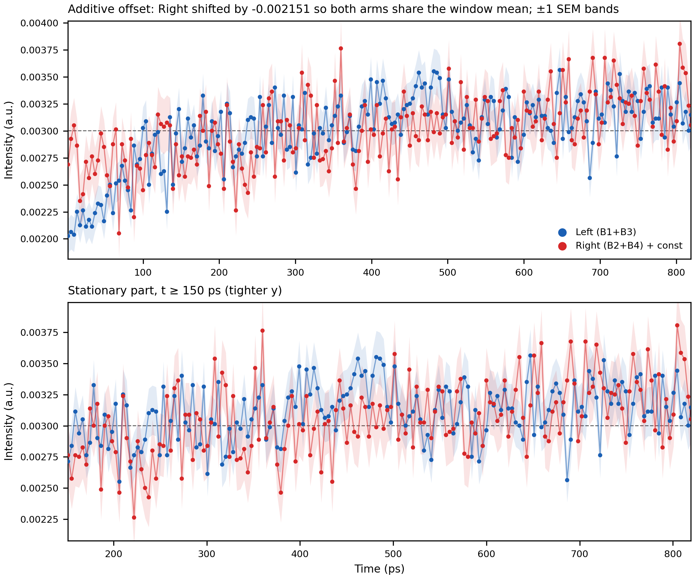

# 在单次扫描 HBT 数据上复现 Adiyatullin et al. 2017 —— 项目报告

**日期：** 2026-08-10 · **状态：** 复现工作已完成（零结果，已量化） · **读者：** 合作者 / 组会 · **PDF：** [26-08-10-project-report-zh.pdf](26-08-10-project-report-zh.pdf) · **English:** [26-08-10-project-report.md](26-08-10-project-report.md)

本报告为我们试图在自己的条纹相机（streak camera）数据上复现 Adiyatullin et al.
"Periodic squeezing in a polariton Josephson junction"（《极化激元约瑟夫森结中的
周期性压缩》），*Nat. Commun.* **8**:1329 (2017) 两项核心测量的工作画上句号。报告按
漏斗结构组织：先讲数据是什么（§2）、如何处理（§3）、以及如何检验处理过程、
其局限何在（§4–§5）；再讲复现结果（§6）、数据*确实*包含的动力学（§7）与结论（§8）。
验证记录与方法比较收录于各附录。

## 结论先行（BLUF）

- **仪器。** 我们搭建了一条面向极化激元约瑟夫森二聚体（Josephson dimer）条纹相机
  帧的单次扫描（single-sweep）、光子分辨亨伯里·布朗–特威斯（Hanbury Brown–Twiss,
  HBT）分析链：以激光参考脉冲给出逐帧时间零点（恒分数甄别，CFD）、逐光子事件
  提取、两个凝聚体 × 两条 HBT 臂的空间带配对，以及论文自己的正规序 g⁽²⁾
  估计量。每一级都在受控输入上做过检验（§4）。
- **复现目标。** 论文图 2(a) —— 两个凝聚体（论文样品中为台面）之间以 ~10 ps 周期
  发生的反相布居交替 —— 以及图 2(c) —— 零延迟 g⁽²⁾ 随该振荡步调在泊松（1）与
  聚束（>1）之间切换（§1）。
- **结果。** 两个可观测量在我们的数据上都未能复现 —— 跨越两个独立采集批次与两次
  独立事件策展（筛选）均是如此。对布居可观测量，零结果是决定性的：上限远低于论文的
  全对比度信号。对 g⁽²⁾，整窗汇总统计量在完整双凝聚体矩阵的所有配对（自关联
  L/R 与交叉 LR/RL）中都与泊松一致，任何参考锁定的振荡
  都被限制在论文幅度区间的顶端之下。全部数字见 §6；一图总览见 §8。
- **零结果背后的检验。** 同一条链能端到端恢复注入的论文型信号；判据在数据分析
  之前即已登记；更长的独立批次收紧了每一项上限而不改变任何结论（§4、§6.3）。
- **数据确实展示的内容。** 约瑟夫森动力学以*相对相位缠绕*的形式存在：k 空间
  同步扫描（synchroscan）图像中倾斜的双凝聚体干涉条纹，在每一帧记录中都以干净的
  周期振荡。在此失谐/运行相位区内，布居几乎不调制 —— 这与实空间零结果一致，
  而非矛盾（§7）。
- **还需要什么。** 覆盖论文 g⁽²⁾ 幅度区间的*下*半段需要大幅延长采集 —— 或者更
  有效地，降低探测器本底（§5 量化了这一权衡）。跨凝聚体 g⁽²⁾（LR/RL）此后已完成
  计算，与其余各项同为泊松一致（§6.2–6.3）；两个批次的策展事件表与计数立方体
  均已归档，仍可供后续的二维 g⁽²⁾(t₁,t₂) 分析使用（§8）。

## 1. 引言与复现目标

### 1.1 物理背景，各一段

**极化激元约瑟夫森二聚体。** 激子–极化激元（exciton-polariton）是半导体微腔中的
光–物质准粒子；限制在两个耦合的圆形台面中（直径 2 µm、中心间距 2.5 µm，论文样品
的隧穿耦合 J = 0.4 meV），两个凝聚体像两个耦合超流体一样交换布居：布居不平衡
z = (N_L − N_R)/(N_L + N_R) 以耦合所设定的周期振荡（论文中 ~10 ps），并受极化激元
寿命（5.2 ps）阻尼。这就是论文直接成像的**约瑟夫森振荡**。

**HBT 与 g⁽²⁾。** 亨伯里·布朗–特威斯装置用 50:50 分束器把发射分成两臂独立探测；
零延迟二阶关联 g⁽²⁾(0) = ⟨n₁n₂⟩/(⟨n₁⟩⟨n₂⟩) 区分泊松发射（g⁽²⁾ = 1）与聚束发射
（g⁽²⁾ > 1）。由于估计量是正规序的，且两臂独立地稀释同一光子流，臂效率不对称在
比值中精确抵消 —— 无需臂标定。论文图 2(c) 报告每个台面的 g⁽²⁾(0)(t) *随约瑟夫森
振荡同相*在泊松与聚束之间切换，两个台面互为反相，聚束峰随布居衰减从 ≈1.2–1.5
增至 ≳2。

**论文在此之外的主张 —— 以及我们不触及的部分。** 论文图 2(d)(e) 的压缩
（squeezing）曲线来自拟合模型而非测量；强度聚束本身并不是正交分量压缩的测量
（那需要相位锁定的本地振荡器与平衡零差探测，两套装置都没有）。本工作只复现
*强度*与*强度关联*测量；我们在两个方向上都不提压缩主张。

### 1.2 目标图


*论文图 2(a)：左（蓝）右（红）台面的累积强度，0–30 ps，对数坐标。衰减包络下
以 ~10 ps 周期反相交替；灰带标出 SNR<20 区域。对 >3.9×10⁶ 个激光脉冲取平均。*


*论文图 2(c)：两个台面的 g⁽²⁾(0)(t)（阴影为 ±1 均值标准误，SEM）随布居振荡
步调在泊松与聚束之间切换，峰随时间增高。*

### 1.3 此处"复现"的含义

论文的测量事实（引自其补充材料 Note 1）：34 h 内 >3.9×10⁶ 个脉冲；在同步扫描条纹
相机上定制光子计数，相机充当两条 HBT 臂的单光子探测器；时间 bin
Δt = 1.296 ps = 2 个探测器 px（0.648 ps/px）；用分出的激光参考脉冲校正逐脉冲时间
抖动（算法未发表）；每台面强度 I = n_L + n_R 对两臂求和；g⁽²⁾ 由逐脉冲计数算出，
误差经 SEM 传播；仪器分辨率 3.4 ps FWHM（半高全宽）。

我们的激发区不同：**由 optical-Stark 脉冲触发、非共振储库（reservoir）馈送的凝聚体**，
在 1 ns 窗口内做实空间成像；论文则是共振成键/反键脉冲与 30 ps 窗口。因此我们复现
的是*测量管线与可观测量形式*，取我们平台能产生的最接近的可观测量，并把区间差异
作为边界陈述（§8），而不是含糊带过。凡论文未记录的方法选择（时间零点算法、光子
阈值、本底处理、L/R 映射），我们都自行制定并加以检验 —— 这些选择及其检验列于
§3 与附录 B。

**覆盖的数据集。** 本工作在 26-08-04 HBT 采集家族上进行：主批次与同条件 3.6×
更长的补充批次。

## 2. 数据：原材料的面貌

### 2.1 数据集

| 数据集 | 内容 | 帧数 | 角色 |
|---|---|---|---|
| `26-08-04-hbt-time-reference`，主条件 `hbt_condensate_josephson_regime` | 单次扫描实空间 HBT 帧，侧面带激光时间参考 | 20 000（保留 19 992；8 帧时间零点失败） | 主批次 |
| 同次采集的另外 8 个条件 | 同步扫描 k 空间 / 实空间图像、无脉冲强度标定、本底、焦点截面、延迟标定 | 各 10 | 标定（k 空间条件驱动 §7） |
| 同一 HBT 条件的补充批次（"New folder (10)"） | 除扫描长度外采集元数据完全相同；信号 ≈ 主批次的 65 % | 72 000（保留 71 971；29 帧失败） | 独立确认（§6.3） |

所有帧均为 1016 × 1344 px uint16 条纹相机图像：**纵轴是时间**（1016 px 对应
1 ns ⇒ 0.984 ps/px，第 0 行 = 窗口起点，依据 `metadata-conventions.toml` 中的采集
元数据约定）；**横轴是未标定的探测器像素**。原始 MAT 文件不可变；分析读取无损的
派生 HDF5 副本，带逐帧溯源信息与 SHA-256，已对源文件做像素级精确核验（补充批次：
498 帧分层抽样，0 处不符）。

### 2.2 测量结构解析


*图 3（C1）。(a) 一次实现：单帧减本底图像（强度取平方根刻度）。发射以稀疏单光子
斑点的形式落在 ~105 counts/px 的基底上；左边缘的亮激光参考脉冲给出每帧的时间
原点 —— 青色实线标出本帧定义它的前沿 50 % 穿越点（CFD50，§3.3）。
探测到的光子事件按帧覆盖预览的同一样式标注：空心圆 = 采纳（质心列落在带窗内），
× = 舍弃（带外）—— 本帧 18 个事件中采纳 8 个。
(b) 主批次全部 275 218 个探测到的光子事件经逐帧对齐后：浮现四条竖直发射带。
(c) 对齐事件的列轮廓：四条带 B1–B4 及其配对 Left = B1+B3、Right = B2+B4（每个
凝聚体同时被两条 HBT 臂成像；210 px 的 B1↔B2 间距与无脉冲标定给出的 204 px 实空间
凝聚体间距相符，430 px 的 B1↔B3 间距即臂间距离）。阴影窗口是峰芯积分窗口，
有意窄于峰的全宽 —— 峰尾主要贡献残余噪声（信噪比优化，附录 B.1）。*

三个结构性事实决定下游一切：

1. **四条带、两个凝聚体、两条臂。** 在单次扫描帧上，每个凝聚体在每条 HBT 臂中各出现
   一次，共四条发射带；按 L = {B1, B3}、R = {B2, B4} 配对可重现无脉冲实空间强度
   比（每臂 0.586/0.579，标定值 0.578），而交叉配对给出不一致的比值（0.59/1.51），
   予以否定。
2. **逐帧时间参考。** 分出的激光脉冲落在同一帧上（约 170–215 列，在探测列之外）。
   扫描的两态漂移 ~13 ps rms（均方根）—— 远大于分析 bin 宽 —— 因此逐帧对齐到
   该参考并非可选。样品脉冲与参考脉冲的延迟测得 0.32 ± 0.20 ps，即与零偏移一致。
3. **实测本底。** 专门的本底条件（不曝光的条纹扫描）给出 ≈105 counts 的逐像素基底，
   逐帧减去；其对补充批次的适用性已直接验证（信号外区域中位数差 +0.02 counts/px）。
   减法余下的是类泊松的残余探测器噪声，它同样会触发光子探测器 —— §5 予以量化。

## 3. 从帧到物理量：测量管线

管线（pipeline）的任务是把 20 000 个原始相机帧变成 §1.2 的两个可观测量：逐凝聚体
的累积强度曲线（Fig. 2(a) 的对应物）与逐凝聚体的零延迟 g⁽²⁾(0)(t)（Fig. 2(c) 的
对应物）。数据的两个性质决定了管线的形状：

- **信号是坐落在大探测器基底上的稀疏单光子发射。** 因此本底必须是*实测*的而非
  拟合的，且光子探测器要尽可能不掺入模型假设。
- **时间基准游走。** 条纹扫描的原点逐帧漂移 ~13 ps rms —— 远大于任何分析 bin
  宽 —— 因此每帧都必须以同一帧上记录的激光脉冲重新对时，之后的任何累积才有
  意义。

这条链共八级：

1. **转换** —— MATLAB 导出 → 经核验的 HDF5 帧。
2. **本底扣除** —— 减去实测的逐像素基底。
3. **逐帧时间零点** —— 在参考脉冲上做 CFD50 定时。
4. **光子事件探测** —— 亮分量查找，每个光子归约为一个事件。
5. **带窗与配对** —— 定位四条发射带；把带归属到凝聚体。
6. **产物** —— 累积曲线、策展的事件表、计数立方体。
7. **g⁽²⁾ 估计量** —— 跨臂符合，带本底修正。
8. **统计策略** —— 功效门与预注册判据。

下面各小节逐级说明做了什么、以及背后的物理理由。各级如何*被检验*（在受控输入
上）是 §4 的主题，完整记录见附录 A；被否决的替代方案及其影响在附录 B 中比较。

### 3.1 转换与溯源

原材料是 MATLAB v7.3 导出文件。转换只把条纹相机载荷复制进逐实验的 HDF5 文件
（schema 2），记录逐帧溯源，并对副本做逐像素精确核验（核验规模与校验和见
§2.1）。任何分析步骤都不触碰原始文件。

*理由。* 两项保证在此阶段代价极低、事后无法补做：原始数据保持不可变；每个派生
数字都可追溯到带哈希的源帧。

### 3.2 本底扣除

每帧带有 ≈105 counts 的逐像素基底（条纹管未曝光电平），由专门的本底条件测得，
逐帧减去。同一测量对补充批次同样适用 —— 这一点已在数据上直接验证（信号外区域
中位数差 +0.02 counts/px，§2.2）。

*理由。* 基底相对单光子斑点很大，在未减基底的帧上做探测，测到的会是基底形状
而非光子。使用*实测*本底而非拟合模型，可避免把模型偏差注入光子探测器。减法
能去掉基底的电平，去不掉它的涨落：余下的是类泊松的残余探测器噪声，它同样会
触发光子探测器。这部分残余并非细枝末节 —— §5 表明它占带内事件的 45–55 %，
是整个测量的第二大误差杠杆。

### 3.3 逐帧时间零点：CFD50

一部分激发激光被分出、落在同一帧上（列 ~170–215，在探测列之外），为每帧提供
自己的时间参考。时间零点 t0 取参考脉冲前沿穿越其峰值 50 % 的行，做子行插值 ——
即恒分数甄别器（CFD），是对付幅度游走（逐发高度变化）与脉冲形状呼吸（宽度
变化）的标准定时方案。样品脉冲与参考脉冲之间的延迟测得 0.32 ± 0.20 ps，与零
一致，故不加偏移修正。参考脉冲未通过信号质量筛选的帧予以排除并记录：主批次
20 000 帧中 8 帧（0.04 %），补充批次 72 000 帧中 29 帧。

*理由。* 不做逐帧对时，13 ps 的两态游走会把一切时间结构涂抹到许多个分析 bin
上。而估计量必须是恒分数的，因为参考脉冲的形状在呼吸：质心或固定阈值穿越会
跟踪这种呼吸，并把它继承为定时误差（+2.7 ps 平均偏差、1.3 ps 逐帧散布 ——
附录 B.2 实测），而 50 % 峰值穿越在构造上免疫。§4 的端到端注入实验在真值上
证实了这一点：CFD50 无偏，为 −0.10 ± 0.33 px（0.32 ps），远低于 4 px 分析
bin。

### 3.4 光子事件探测

在探测列 350–1150 内，探测器查找 8-连通亮分量（阈值以上的连续像素团），保留
积分幅度（减本底后）≥ 25 counts 且大小 ≥ 2 px 者，并把每个分量归约为计数
加权的亚像素质心。25 counts 的阈值取自灵敏度扫描的拐点。

*理由。* 一个光子点亮的不是一个像素：它在微通道板（MCP）增强器上触发一片多
像素电荷云。把每片云积分回一个分量，即恢复"一个光子一个事件"，质心则给出
亚像素位置。由此引入的定位误差为逐轴 0.16–0.17 px RMS（§5、附录 B.3）——
在 1–4 px 的分析 bin 下无关紧要。

### 3.5 带窗与配对

§2.2 的四条发射带在光子事件的列直方图上定位：直方图折叠成 10 px 子窗，基线
及其 σ 取自最低 40 % 的子窗，带为高于基线 + 5σ 的连续区段，并以基线 + 2σ 做
间隙桥接。这是一条纯计数阈值规则 —— 不做任何轮廓拟合。它运行在*事件*直方图
而非模拟强度轮廓上，有具体的原因：事件直方图的带外基底是平坦泊松的、可以
阈值化，而模拟轮廓坐落在块状的固定图案基线上，任何 σ 规则都无法干净地阈值化
（附录 B.1）。

所得窗口为 B1 = 380–450、B2 = 570–680、B3 = 810–880、B4 = 1010–1110 px。它们
是刻意的峰*芯*积分窗，窄于峰的完整宽度：远离带中心处信号密度下降，而残余
噪声密度保持平坦，尾部贡献的主要是噪声。对 S/√(S+N) 的宽度扫描表明，这些
窗口距信噪比最优在 0.6 % 以内（附录 B.1）。最后把带配对成凝聚体 ——
Left = {B1, B3}、Right = {B2, B4} —— 依据 §2.2 的几何检验：B1↔B2 间距与
标定的凝聚体间距相符，B1↔B3 间距与臂间距相符，且只有这种配对能复现无脉冲
标定的强度比。

### 3.6 产物：曲线、事件表与计数立方体

同一次探测扫描产出分析所需的一切，共三种同步产物：

- **累积曲线。** 逐带、对齐到逐帧时间零点（子行精度）后的均值/SEM 强度-时间
  曲线 —— 来自两个平行来源：*光子*（事件计数）与*模拟*（积分计数）。它们
  喂给 §6.1 的布居可观测量。
- **事件表。** 策展的逐光子列表 —— 帧号、亚像素 x/y、抖动校正后 τ = y − t0、
  幅度：主批次 275 218 事件，补充批次 661 090。它是 §8.3 后续分析的归档形式。
- **计数立方体。**（帧 × 4 带 × 时间 bin）计数数组，bin 宽 1/2/4 px ——
  g⁽²⁾ 估计量的直接输入。

由于表与曲线出自*同一遍*扫描，其一致性可机械检验：每次提取末尾自动做
表→曲线重建测试（整数计数必须能重建出曲线；容差与记录见附录 A.5）。

### 3.7 g⁽²⁾ 估计量

对每个凝聚体，估计量逐时间 bin 关联其两条带的*跨臂*计数：L 为 B1×B3，R 为
B2×B4。每种配对都是凝聚体与*自身*的关联 —— 经 50:50 分束后，两条臂是同一
发射的两个独立副本 —— 因此 L、R 分别是左、右凝聚体的自关联。凝聚体 1×凝聚
体 2 的交叉关联由同一估计量以跨臂对 LR = B1×B4、RL = B2×B3 计算 —— 二者是
同一 g⁽²⁾_LR 的两次独立测量（同臂交叉对 B1×B2 / B3×B4 共享同一条 streak
迹线及其固定图案噪声，故不采用）；结果见 §6.2–6.3。

逐时间 bin，g⁽²⁾(0) 是论文的正规序比值：两臂逐帧计数 n₁、n₂ 的
g⁽²⁾(0) = ⟨n₁n₂⟩/(⟨n₁⟩⟨n₂⟩)，对帧取平均。由于比值是正规序的、且两臂独立地
稀释同一光子流，（不等且未知的）臂效率精确相消 —— 无需臂标定（§1.1）。

残余探测器噪声进入比值的每一项，必须修正而非忽略。其逐带逐 bin 的期望计数 β
由同一时间 bin 的带外事件测得（带外密度沿 τ 平坦，χ²/ndf = 1.16，附录 A.1）；
估计量从逐臂均值中减去 β、从符合矩中减去相应的乘积项，从而无偏地去除噪声对
g⁽²⁾ 的贡献。减法去不掉的是噪声额外带入的计数方差 —— 这一代价在分析侧不可
约，转入 §5 的误差预算。

§6 出现两种误差棒，因为问的是两个不同的问题。逐 bin *展示*的带是零假设解析
（"plug-in"，代入式）SEM：在每 bin ~10⁻³ 的占据数下，单 bin 的高斯误差棒
没有意义，误差带改为展示实验在泊松线附近的分辨能力 —— 它回答的是"此处若有
偏离，我们能看到吗？"。*整窗汇总*值回答的是"平均 g⁽²⁾ 是否泊松？"，采用
留一帧刀切法（jackknife）SEM，经蒙特卡洛标定（附录 A.3）。

### 3.8 统计策略：功效门与预注册

两条规则在真实数据 g⁽²⁾ 被计算*之前*即已固定：

- **功效门（power gate）。** 用实测的带速率与残余噪声密度，在运行估计量*之前*
  算出该数据集能分辨什么：逐 bin SEM、汇总精度、逐周期的振荡灵敏度。功效门的
  判定是"临界"—— 只覆盖论文振幅区间的上半（§5）—— 事先约定的后果是
  交付物从"发现声明"降级为"上限报告"。§6 正是这份上限报告。
- **预注册判据。** 四个科学检验（聚束存在性、振荡、反相、包络增长）及其
  统计量、替代数据零假设构造、显著性阈值，于 2026-08-06 先于计算写下
  （附录 A.1）。任何阳性结果还须额外通过注入恢复（§4）；未触发任何一次。

*理由。* 零结果只有在判据未事后迁就数据时才有信息量。功效门还让零结果*定量
化* —— 它把"什么也没看到"变成"此振幅以上不存在任何东西"，即 §6 的 UL95
数字。

## 4. 已知信号的恢复

对上述链的检验，是看它能否恢复我们植入的信号 —— 端到端，从合成帧穿过未改动
的生产代码。


*图 4（C2）。左：在合成帧中端到端恢复注入的反相布居振荡（周期 9.84 ps —— 论文的
约瑟夫森周期 —— z 幅度 0.5，锁定到真实逐帧时间零点），合成帧携带**实测**的参考
脉冲形状及其真实的帧间呼吸、实测本底水平与观测到的两态时基漂移。上：恢复出的
z(t) 以 9.87 ps 振荡，幅度符合（噪声稀释后的）预期。下：逐帧时间零点误差 ——
CFD50 无偏（−0.10 ± 0.33 px）；旧质心估计量有 +2.71 px 偏差与 1.25 px 散布，因为
它跟踪脉冲形状呼吸，这正是管线采用 CFD50 的原因。右：立方体级 g⁽²⁾ 注入 —— 把
论文式调制（9.84 ps、反相、增长包络）加到真实实测速率与残余本底上：两种注入强度
下系综幅度偏差都在预设的 10 % 接收判据内；论文强度下单副本检出率（L 19 %，
R 50 %）正是功效门"临界"判定的直接经验读数（§5）。*

三个补充，详见各附录：

- **通过策展的"数据集 A"链做帧级注入**（把真实事件斑块植入真实帧）：98.8–99.6 %
  的注入斑点在策展后存活，时间零点零扰动，注入的 9.84 ps 调制以预期幅度恢复
  （附录 A.4）。
- **合成输入上的估计量偏差检验**：在合成泊松立方体上，g⁽²⁾ 估计量在蒙特卡洛容差内
  返回 1；解析 SEM 与 64 副本蒙特卡洛在工作 bin 宽下吻合到 4 % 以内（附录 A.3）。
- **对方法选择的稳健性**：在替代时间零点估计量、替代（四高斯）带窗语义、替代
  （全局均值）本底模型下结论完全相同 —— 每项比较都在附录 B 中量化。

## 5. 误差分析与分辨能力

精确知道测量*看不到*什么，§6 的零结果才有信息量。误差预算分解如下（数字为主批次；
补充批次相应缩放）。

**事件定位**（同一条纹相机上的人工斑点注入研究，`DOCS/peak-localization-error.md`）：
每轴 0.16–0.17 px RMS，由确定性亚像素窗口截断偏差主导（0.13 px），而非探测器
噪声（0.002 px）；斑点恢复完整度 92 %。在 1–4 px 分析 bin 宽下无关紧要。

**时间零点。** 逐帧扫描漂移 13.2 ps rms（两态，真实同步扫描行为 —— 两种计时估计量
在 0.1 ps 内一致）。CFD50 对齐后残余估计量噪声 0.33 px ≈ 0.32 ps，远低于 4 px
（3.94 ps）的 g⁽²⁾ bin。

**g⁽²⁾ 的统计预算。** 在符合计数极限下，

SEM[g⁽²⁾(0)] ≈ 1/√(F·s₁·s₂) × 1/√(purity₁·purity₂)，

其中 F 为帧数，s 为单臂信号速率，purity = 信号/(信号+噪声)。实测：

| 因子 | 数值 | 后果 |
|---|---|---|
| 帧数 F | 19 992（主）/ 71 971（补充） | SEM ∝ 1/√F |
| 信号速率 s | 0.50–1.21 事件/帧/臂（0–820 ps） | 二次杠杆 |
| 残余探测器噪声 | **带内事件的 45–55 %** | SEM ×2.0–2.3 ⇔ 损失 4–5× 帧数 |
| bin 宽 × 周期 | sinc 惩罚 9.84 ps 处 1.32×，74.4 ps 处 ≈1（4 px bin） | 在我们的（更长）周期下无害 |
| 时间零点残余 | 0.32 ps | 可忽略 |

噪声份额是第二大的杠杆，且**在分析侧无药可救** —— 信号与噪声事件是同一种 MCP
电荷云对象（幅度/尺寸分布重合；最好的逐事件甄别器只达 1.7:1，而盈亏平衡需 3:1），
探测阈值 25→70 counts 以 6 % 信号代价去除 11 % 噪声，收窄窗口仅得 1–4 %。只有
采集侧的本底降低有效 —— 且是二次方地有效：噪声减半 ≈ 帧数翻倍。

**相对论文的分辨能力。** 下图是测量的频率相关 95 % 灵敏度下限，在估计量运行之前
由实测速率算出（即功效门），经蒙特卡洛验证：


*图 5（C3）。可分辨的最小参考锁定 g⁽²⁾ 振荡幅度（95 %）对周期，1/2/4 px bin；
灰带 = 论文图 2(c) 的幅度区间（g⁽²⁾−1 ≈ 0.2–1.2）。4 px 宽度对两条臂均通过蒙特
卡洛验证，是工作宽度。数据集覆盖论文区间的上半段。*

当前速率下的帧数展望（4 px，反相结合中位数 / 9.84 ps 处）：20 k 帧 → 0.78 / 1.01
（实测：0.81 / 1.09 —— 功效门是准的）；72 k → 0.41 / 0.53；92 k 合并 →
0.36 / 0.47；**≈3×10⁵ 帧 → 0.20 / 0.26**，可覆盖论文下界。

## 6. 复现结果

管线的局限已量化，下面是它在真实数据上的测量结果。

### 6.1 布居动力学：无反相交替


*图 6（C4）。论文图 2(a)（左）与本工作（右）：累积 Left（B1+B3，蓝）与 Right
（B2+B4，红）强度，对数坐标，峰值归一化，19 992 帧。曲线是平的；早期（t ≲ 150 ps）
的左侧凹陷是单调过阻尼恢复，不是振荡。论文的全对比度反相交替不存在。（图内嵌的
说明文字引用扫描值为 0.008–0.019、中位数 0.012 —— 以正文下列数值为准。）*

定量地，对 z = (I_L − I_R)/(I_L + I_R)：

- 跨臂去趋势涨落相关不显著（r = 0.030，置换 p = 0.525；r = 0.095，p = 0.145，
  两种 bin 宽）。
- 对 3–200 ps 周期做参考锁定正弦扫描，z 幅度的 95 % 上限为**中位数 0.0123 /
  最差 0.0193** —— 即 ≈1–2 % 强度调制，而论文测得的信号为全对比度
  （z ≈ ±0.4–0.5）。在先验周期处的定向拟合：
  9.84 ps |A| = 0.0041（UL95 0.0116）；74.4 ps 0.0038（0.0113）；
  83.7 ps 0.0090（0.0165）。
- 最直接的观察 —— 图 7 的加常数 offset 放大图 ——
  发现误差带处处重叠，且有弱的**正**共模相关（r = +0.174，p = 0.023）：缓慢的
  共同漂移，符号与反相相反。



*图 7。图 6 曲线的加常数 offset 放大图：Right（B2+B4）臂平移常数
c = mean(L) − mean(R)，使两臂共享 0–820 ps 窗口均值，再以放大的线性强度坐标
叠加 ±1 SEM 带绘制。与图 6 的乘性峰值归一化不同，加性平移保持各臂噪声幅度
不变，因此误差带的重叠 —— 或反相跷跷板式起伏（若存在）—— 可直接判读。
上：全窗口；下：平稳段 t ≥ 150 ps（更紧的 y 轴）。误差带处处重叠；残余相关
弱为正（共模漂移）。*


*图 8。这些数字背后的扫描：拟合的 z 振荡幅度及其 |A|+2σ 95 % 上限对周期（左，对数
坐标），以及去趋势的合并 z(t) 及其 ±1 SEM 带（右）。没有任何周期突出；上限处处
保持在 1–2 % 水平。*

### 6.2 光子统计：与泊松一致，无聚束切换


*图 9（C5）。论文图 2(c)（左）与本工作（右）：每个凝聚体的 g⁽²⁾(0)(t)
（L = B1×B3 蓝，R = B2×B4 红），4 px bin；阴影带是实验在泊松线附近的分辨能力
（plug-in SEM，§3.7）。曲线按构造逐 bin 受统计限制；信息在汇总值与振荡
上限中。*

- **整窗汇总 g⁽²⁾(0)**（0–820 ps，4 px，刀切法）：**L = 0.310 ± 0.380**，
  **R = 1.114 ± 0.188** —— z = −1.82 / +0.60，两者都与泊松一致（|z| < 2，
  预注册阈值）。
- **跨凝聚体 g⁽²⁾(0)**（跨臂对 LR = B1×B4、RL = B2×B3 —— §3.7）：
  **LR = 0.659 ± 0.265**、**RL = 0.875 ± 0.281** —— z = −1.29 / −0.44，同样与
  泊松一致。至此双凝聚体 g⁽²⁾ 矩阵（LL、RR、LR、RL）完整：四项在当前统计下
  全部为零 —— 两凝聚体之间既无任何符号的强度关联，也无自聚束。
- **四个预注册检验**（判据 2026-08-06 先于计算固定；200 个循环移位替代数据）：
  (a) 无显著聚束/反聚束 bin（p = 0.32 / 0.86）；(b) 无显著参考锁定振荡（合并
  p = 0.15）—— 3–200 ps 上 95 % 上限**中位数 0.812**，论文 9.84 ps 周期处
  1.086，实测 k 空间周期 74.4 / 83.7 ps 处 0.680 / 0.540；(c) 无反相 —— 去趋势
  L/R 相关弱*为正*（r = +0.100，p = 0.886 单侧），与 §6.1 的共模漂移呼应；
  (d) 无包络增长（晚减早汇总 g⁽²⁾−1：L +0.159，p = 0.45；R +0.176，p = 0.37）。

### 6.3 一个独立批次与一次独立策展给出相同结论

**补充批次**（71 971 帧，同条件，紧接采集；因其信号速率 ≈ 主批次的 65 %，独立
分析）：同样平坦的曲线（反相 UL95 中位数 **0.0084**），汇总 g⁽²⁾(0)
L = 1.304 ± 0.320 / R = 0.990 ± 0.117（与泊松一致），交叉对 LR = 1.110 ± 0.190 /
RL = 1.065 ± 0.200（同为一致），四个预注册检验全部为零，
振荡 UL95 中位数 **0.496**。每项上限都收紧；每个结论都成立
（[fig2a](../analysis/26-08-04-derived-hbt-time-reference/fig2a_replica_supplement.png) /
[fig2c](../analysis/26-08-04-derived-hbt-time-reference/fig2c_replica_supplement_bin4px.png)
补充图版）。

**数据集 A** —— 一次策展的重新提取，只保留物理上可能是凝聚体信号的事件（带内、
避开那一根缺陷列、不触及帧边缘；主批次 275 218 个事件中保留 161 357 个，已验证为
精确子集），并以逐带局部噪声基底替代全局均值 β：结论相同而上限更紧（布居 UL95
0.0131，噪声稀释修正后 0.0226；g⁽²⁾ 振荡 UL95 中位数 0.58；补充批次的数据集 A：
布居 UL95 0.0083，g⁽²⁾ 振荡 UL95 中位数 0.488），交叉对依然与泊松一致
（LR = 0.770 ± 0.179 / RL = 0.936 ± 0.203 主批次；LR = 1.075 ± 0.174 /
RL = 1.076 ± 0.183 补充批次），且因更纯的噪声模型获得更好的
论文强度注入检出（L 31 % / R 81 %）。

在管线变体、窗口选择与噪声模型的各种变化下，零结果都持续存在 —— 在已尝试的
范围内，它跟随的是数据。

## 7. 确实看到的动力学：k 空间中的相位缠绕

合作者期待的振荡确实存在于装置中 —— 只是不以实空间布居调制的形式出现。


*图 10（C6）。同步扫描 k 空间图像（相机内部累积，因此不受逐帧时基漂移影响）：双
凝聚体干涉图样形成倾斜棋盘格 —— 随时间倾斜的条纹即随时间缠绕的相对相位。固定
k 列以主周期 **74.4 ps** 振荡（10 个 k-bin 中 9 个；次周期 83.7 ps），在 10 帧中
每一帧单独可见（二维 FFT 峰/中位数比 11–18）。无脉冲 k 空间标定只显示光滑的静态
发射包络 —— 无条纹图样 —— 排除条纹源于探测器；74.4 ps ≈ 13.4 GHz 远高于已知
电学拾取干扰。*

相位缠绕而布居几乎不调制，是失谐、运行相位约瑟夫森区的特征 —— 正是在这个区内，
图 2(a) 型的*布居*可观测量保持平坦。k 空间测量与实空间零结果是同一状态的两种
视图，且彼此一致。要在单次扫描层面分辨相位动力学，需要逐帧 k 空间成像或逐帧
似然分析 —— 那是另一种采集，列于 §8。

## 8. 结论


*图 11（C7）。全部定量结论一图总览。上：两个批次、两次策展的布居振荡 95 % 上限
（z 空间），对照论文全对比度带。中：g⁽²⁾ 振荡 95 % 上限，对照论文幅度区间。
下：整窗汇总 g⁽²⁾(0)—— 完整双凝聚体矩阵，自（L、R）与交叉（LR、RL）配对 ——
及 ±1 SEM，对照泊松线。每项上限都远低于相应的论文信号；
每个汇总值都在误差内落在泊松上。*

### 8.1 逐条主张的对照

| 论文主张（可观测量） | 本工作 | 判定 | 证据 |
|---|---|---|---|
| 图 2(a)：反相布居交替，~10 ps，全对比度（实测 z ≈ ±0.4–0.5） | 曲线平坦；UL95 为 z 的 1.2 %（主）/ 0.8 %（补充）/ 2.3 %（数据集 A，稀释修正后） | **未复现 —— 决定性**（论文信号 ≳ 上限的 30×） | §6.1，图 6 |
| 图 2(c)：g⁽²⁾(0)(t) 随振荡同相在泊松↔聚束间切换，峰 1.2→≳2 | 汇总与泊松一致；振荡 UL95 按批次/策展为 0.81 / 0.50 / 0.58 / 0.49；四个预注册检验全部为零 | **在灵敏度内未复现**（上限覆盖论文区间上半段） | §6.2，图 9 |
| 两凝聚体间反相（两种可观测量） | 两者都呈弱的*正*共模相关（r = +0.17 强度；r = +0.10 g⁽²⁾） | **未复现；符号相反** | §6.1–6.2 |
| 聚束包络随时间增长 | 晚−早差与零一致 | **未复现** | §6.2 (d) |
| 器件中存在约瑟夫森动力学 | 确认 —— 以 k 空间 74.4 ps 相对相位缠绕的形式，布居不调制 | **确认，但在另一正交分量上** | §7，图 10 |

### 8.2 边界（本工作未说的内容）

1. 物理区间不同：共振脉冲成键/反键激发、30 ps 窗口（论文）vs 非共振储库馈送 +
   Stark 脉冲、1 ns 窗口（本工作）。我们复现的是测量管线与可观测量形式，不是
   同一个态。
2. g⁽²⁾(0) > 1 无论如何也不会是正交分量压缩；论文图 2(d)(e) 的压缩曲线来自模型，
   从未在范围内。
3. "与约瑟夫森振荡同相"在此处只能相对激光参考脉冲而言，因为布居振荡本身在实
   空间缺席。
4. 两个批次物理上有差异（信号速率、L/R 比），故各自独立分析，不合并。
5. 本文不涉及单脉冲轨迹问题（逐帧/层级分析）—— 按设计保持开放。

### 8.3 下一步

- **二维 g⁽²⁾(t₁,t₂)**（论文图 3）：两个批次的事件表与计数立方体已归档，正为此
  准备。（此前列于此处的跨凝聚体 LR/RL 关联已于 2026-08-11 完成计算，与自关联
  同为零结果 —— §6.2–6.3。）
- **统计量**：当前速率下 ≈3×10⁵ 帧可覆盖论文 g⁽²⁾ 下界；探测器本底减半 ≈ 值 2×
  帧数（仅采集侧）。
- **单次扫描层面的相位动力学**：逐帧 k 空间成像或逐帧似然分析，动机见 §7。
- **开放的计量缺口**：绝对的行→ps 标定基于元数据；数据内标定仍是待办（它不影响
  本文任何结论 —— 所有周期都在帧内测量）。

**宣告。** 针对 Adiyatullin et al. 2017 图 2(a) 与图 2(c) 的复现工作**已完成**：
两个可观测量都在两个独立批次、两次策展上测量，所用管线的每一级都经过受控输入
检验（§4、附录 A）；结果为零，上限已量化；仪器的分辨能力已知，其相对论文低幅度
区间的缺口已量化并给出具体补救方案。

---

## 附录 A. 验证记录

### A.1 预注册与功效门

- 四个科学检验（聚束存在性、振荡、反相、包络增长）及其统计量、替代数据构造与
  显著性阈值，于 **2026-08-06、在任何真实数据 g⁽²⁾ 计算之前**写入
  `DOCS/26-08-04-fig2c.md` §G6。偏离泊松要求 |z| ≥ 2（汇总）或替代数据标定的
  p < 0.05（检验）。
- **功效门**（G3）在完整管线之前运行：由实测带速率与实测带外残余噪声密度（在 τ
  中平坦，χ²/ndf = 1.16）预测逐 bin SEM 中位数、汇总精度（L ±0.41 / R ±0.18 ——
  实测刀切法：0.38 / 0.19）与振荡灵敏度（中位数 0.78 —— 实测 0.81）。其"临界"
  判定（论文 0.2–1.2 区间只有上半段被覆盖）触发了预先约定的降级为上限交付物，
  并于 2026-08-06 与用户确认。补充批次的功效门以同样方式通过（预测 0.52，
  实测 0.50）。

### A.2 替代数据零假设分布

把一条臂的逐帧计数随机循环移位一个帧偏移，打破同帧符合，同时保留各臂的速率结构
与 t0 结构；200 个替代数据穿过完全相同的统计量管线。跨 bin/周期的多重性通过在
数据与替代数据上同取扫描最大值统计量（max|z|、max|A|/σ）来控制。


*工作 4 px 宽度下的振荡检验：两对及反相结合的拟合 |A| 扫描与合并 UL95 曲线（左；
虚线标出先验周期 9.84 / 74.4 / 83.7 ps），以及观测到的扫描最大值统计量相对其
替代数据零假设分布（右；p = 0.154）。*

### A.3 解析误差的蒙特卡洛标定

64 个合成泊松副本穿过估计量链：在工作 4 px 宽度下，解析 UL95 与蒙特卡洛对两对都
吻合到 4 % 以内（比值 1.04/1.01 —— 通过）；2 px 对 R 通过（1.03）但对 L 不通过
（1.54 —— 重尾；仅定性使用）；1 px 失败（尖峰主导）。汇总刀切法 SEM 落在蒙特卡洛
的 0.86–1.07 内。补充批次：4 px 与 2 px 比值在 [1.000, 1.024] 内；1 px L 同样
失败。该标定是全文以 4 px 为报告宽度的依据。

### A.4 注入记录（完整）

| 检验 | 注入 | 恢复 | 判定 |
|---|---|---|---|
| fig2a 型帧级，真实参考形状（1500 个合成帧） | z = 0.5 反相，9.84 ps | 周期 9.87 ps；t0 偏差 −0.10 px，标准差 0.33 px；幅度符合噪声稀释预期 | 通过（周期误差 <2 %） |
| fig2c 型立方体级，强（峰 g⁽²⁾−1 = 6→8），16 副本 | 9.84 ps 反相，增长包络 | 系综偏差 L −4.5 %，R −9.0 %；周期在 2 % 内：L 11/16，R 16/16；全部副本显著 | 通过（偏差 <10 %） |
| fig2c 型立方体级，论文强度（1.5→2），16 副本 | 同上 | 系综无偏（L +4.1 %，R −5.6 %）；单副本检出 L 19 %，R 50 % | 无偏；部分检出 = 临界区 |
| 补充批次立方体级 | 同样协议 | 强：L +0.2 %，R −4.1 %；论文强度：L −7.4 %，R +4.3 %，检出 L 19 %，R 81 % | 通过 |
| 数据集 A 立方体级 | 同上 | 强：L −2.2 %，R −7.9 %（主），L −9.2 %，R −4.6 %（补充）；论文强度检出 L 31 %，R 81–100 % | 通过；纯度增益转化为检出率 |
| 数据集 A 帧级（真实帧 + 394 个真实事件斑块） | z 模式：2856 帧内 10 867 个斑点；聚束模式：252 个斑点（126 个跨臂对） | 存活率 98.8 % / 99.6 %；t0 零扰动；恢复幅度在 10 % 内符合稀释预期 | 通过 |

### A.5 提取自洽性

事件表与 fig2a 曲线出自同一次探测扫描；每次完整提取末尾自动做表→曲线重建校验
（整数计数判据：float64 bin 边界并列造成 ≤2 counts/bin：主批次四个带为 [1,1,1,2]
counts —— 通过；补充批次 14–39 counts/带 = 带事件的 0.015–0.044 %，容差相应
缩放 —— 通过）。时间零点失败的帧被排除并记录（主：帧 3543、4458、4589、6614、
7935、8190、9765、11225；补充：29 帧，0.04 %）。

## 附录 B. 方法比较

这些比较为每项生产选择提供依据；没有任何一项会改变结论。

### B.1 带窗确定

生产方法（自 2026-08-05 起）：在**光子事件列直方图**上定位带（带外基底是平坦泊松；
模拟轮廓的固定图案基线不可阈值化），折叠进 10-px 子窗；基线与 σ 取自最低 40 %
子窗；带 = 高于基线+5σ 的游程，以基线+2σ 做间隙桥接；触及探测列边缘的游程作为
截断伪影丢弃。

- **对比四高斯归属规则。** 窗口来自上述计数阈值规则，而非拟合。作为宽度参照，
  对主批次直方图做常数本底 + 四高斯拟合，收敛到 μ = 415.9/623.7/845.0/1061.2 px
  （距窗口中心 ≤1.5 px），σ ≈ 34.5–37.9 px；生产窗口相当于这些峰的
  ≈ μ±(1.0–1.45)σ —— 峰芯*积分*窗口。μ±2σ 的归属式规则则会给出 170–190 px
  窗口（宽 2–3×），并把残余噪声份额推过 50 %。
- **S/N 最优性。** S/√(S+N) 宽度扫描把生产窗口放在距最优 0.6 % 以内（后来的全行
  细化：B2/B4 约 ~1 %，较窄的 B1/B3 约 ~6–7 % —— 这是 fdr-snr 建议的依据，而非
  事后修改）。
- **八方法研究**（`DOCS/26-08-08-band-window-methods.md`）：八个候选探测器 × 两个
  批次，外加参数平台、增长曲线与合成台阶基准，推荐局部基底泊松-FDR 探测 +
  S/N 最优宽度（"fdr-snr"）作为未来默认；它无需手动调参即可重现人工设定的补充
  批次窗口（FOM 在 0.1 % 内）。该研究还剖析了生产方法在补充批次上的失败：B1 的
  超阈值游程触及探测列 350，截断过滤器丢弃整条带（2026-08-10 把边缘移到 330 的
  重跑确认堆积跟随边界移动 —— 是方法问题，不是边缘位置问题）。两个批次的最终
  窗口早于该研究，保持不变。
- **结论稳定性：** 所有下游结果在适用的替代窗口语义下重查（§6.3 数据集 A 使用
  S/N 最优窗口）—— 结论不变。

### B.2 时间零点估计量

在全部 19 992 个配对帧上比较质心与 CFD50：质心 − CFD50 = +2.78 px（+2.73 ps）
均值 —— 质心被脉冲的重尾拖晚 —— 逐帧散布 1.37 px（1.34 ps），来自形状呼吸。
注入实验（§4）对地面真值给出同样数字（CFD50 −0.10 ± 0.33 px；质心
+2.71 ± 1.25 px），且恢复的振荡周期不受影响。零结果已在质心变体下显式复验
（UL95 0.013–0.020 vs 0.012–0.019）。CFD50 是生产选择，理由既有原理（恒分数计时
是幅度/形状游走的正确解法）也有上述证据。


*全部 19 992 个配对帧上的质心 vs CFD50：逐帧估计量差（均值 +2.73 ps，标准差
1.34 ps）在整个采集中稳定。*

### B.3 事件定位

生产：trackpy（Crocker–Grier）计数加权质心，diameter 7，minmass 300。对照上述
探测器研究中 1 518 个峰的圆对称二维高斯拟合（`DOCS/peak-localization-error.md`）：
92.2 % 在 0.2 px 内一致，中位数 0.052 px，无系统性偏移；高斯拟合在非高斯拉长
MCP 电荷云（边缘碰撞）上失败，质心不失败。误差预算见 §5。

### B.4 残余噪声模型与数据集 A

旧管线：β 取自**全局**带外密度均值。调查表明噪声基底在 x 方向是稳定的固定图案
（块相关 0.97），因此全局均值会把逐带基底估错 ±30–50 %。数据集 A 使用**逐带局部
线性基底**（35 px 拟合窗口，30 px 保护带，对照实测 25–30 px 信号尾巴；B1 朝探测
边缘单侧），平均低 ≈20 %；基底变体夹住系统误差。对头条数字的影响：汇总 g⁽²⁾(0)
L 0.531（局部）vs 0.307（全局）—— 夹逼区间小于 ±0.38 统计误差 —— 且旧全局
变体几乎逐比特重现策展前数字，确认了估计量链。策展本身：移除带外、缺陷列（主：
676 列；补充：11 根热列）与触及帧边缘的事件；形态学切割经评估后否决（信号与噪声
是同一种 MCP 电荷云对象；最佳甄别器 1.7:1 vs 盈亏平衡 3:1）。

### B.5 无效的手段

提高探测阈值（25→70 counts）：−11 % 噪声、−6 % 信号，品质因数不变。绕峰芯收窄带窗：
增益 1–4 %。两者均在 500 帧 / 子窗研究上探查；唯一有效的杠杆是采集侧本底降低
（§5）。

## 附录 C. 复现命令

每一级的完整命令集收录在其执行文档中（附录 D）：转换（`DOCS/data.md`、派生目录
README），fig2a 管线（`DOCS/26-08-04-fig2a.md` §复现），fig2c 管线含功效门 /
科学检验 / 注入（`DOCS/26-08-04-fig2c.md` §复现），补充批次
（`DOCS/26-08-06-hbt-supplement.md` §复现），数据集 A（`DOCS/26-08-08-dataset-a.md`）。
报告图从工作树根目录重新生成：

```powershell
.\.venv\Scripts\python.exe analysis\26-08-10-project-report\render_report_data_preview.py
.\.venv\Scripts\python.exe analysis\26-08-10-project-report\render_report_injection.py
.\.venv\Scripts\python.exe analysis\26-08-10-project-report\render_report_summary.py
.\.venv\Scripts\python.exe `
  analysis\26-08-04-derived-hbt-time-reference\measure_kspace_fringe_oscillation.py `
  --h5 <derived H5> --out analysis\26-08-10-project-report\figures\fig_kspace_fringe.png
```

PDF 版本（`DOCS/26-08-10-project-report-zh.pdf`）从工作树根目录用 pandoc + XeLaTeX
构建；全部引擎/字体/过滤器设置在
`analysis/26-08-10-project-report/pdf_build_zh.yaml`（Cambria 排印西文与希腊字母/符号，
Microsoft YaHei 排印中文，另有一个 Lua 过滤器让长代码段在表格单元格内折行）：

```powershell
pandoc docs\26-08-10-project-report-zh.md -o docs\26-08-10-project-report-zh.pdf `
  --defaults=analysis\26-08-10-project-report\pdf_build_zh.yaml
```

## 附录 D. 子报告索引

| 文档 | 在本报告中的角色 |
|---|---|
| `DOCS/adiyatullin2017-fig2a.md` / `adiyatullin2017-fig2c.md` | 论文侧事实档案 + 目标分解（G 判据）—— §1 来源 |
| `DOCS/26-08-04-fig2a.md` | fig2a 管线、带窗、零结果 + 灵敏度 —— §3、§6.1 |
| `DOCS/26-08-04-fig2c.md` | 功效门、预注册检验、上限报告 —— §3.8、§6.2、附录 A |
| `DOCS/26-08-06-hbt-supplement.md` | 72 000 帧补充批次 —— §6.3 |
| `DOCS/26-08-08-dataset-a.md` | 数据集 A 策展 + 下游重分析 —— §6.3、附录 B.4 |
| `DOCS/26-08-08-dataset-a-noise-model.md` | 噪声基底结构 —— §5、附录 B.4 |
| `DOCS/26-08-08-band-window-methods.md` | 八方法带窗研究 —— 附录 B.1 |
| `DOCS/08-04_sync_oscillation.md` | 时间零点估计量论证 —— 附录 B.2 |
| `DOCS/sem-limitations.md` | SEM 因式分解 + 帧数表 —— §5 |
| `DOCS/peak-localization.md` / `peak-localization-error.md` | 定位方法 + 误差预算 —— §5、附录 B.3 |
| `DOCS/measurement-claims.md` | 主张/证据边界 —— §1.1、§8.2 |
| `DOCS/streak-time-axis.md` + `metadata-conventions.toml` | 时间轴约定 —— §2.1 |
| `DOCS/data.md` | 数据完整性与环境约定 —— §2.1 |
| `DOCS/experiment-plan.md` / `literature.md` | 项目门径；文献状态（未发现对 2017 结果的独立复现） |

## 附录 E. 图表溯源

| 图 | 来源 | 生成器 |
|---|---|---|
| 图 3（C1）数据预览 | 本报告 | `analysis/26-08-10-project-report/render_report_data_preview.py`（输入：派生 H5 + 策展事件表） |
| 图 4（C2）注入 | 本报告 | `render_report_injection.py`（重跑帧级注入；g⁽²⁾ 面板读取 `drafts/26-08-06_fig2c/fig2c_injection_report.json`） |
| 图 5（C3）灵敏度 | `drafts/26-08-06_fig2c/power_gate_ul95_vs_period.png`（复制） | `fig2c_power_gate.py` |
| 图 6（C4）fig2a 复制品 | `analysis/26-08-04-derived-hbt-time-reference/fig2a_replica.png` | `render_fig2a_comparison.py` |
| 图 7 offset-zoom | `analysis/26-08-04-derived-hbt-time-reference/fig2a_offset_zoom.png` | `render_offset_zoom.py` |
| 图 8 z 上限谱 | `figures/fig_z_upper_limit.png`（复制自 `drafts/26-08-06_fig2a_cfd50/`） | `tmp/fig2a_upper_limit_cfd50.py` |
| 图 9（C5）fig2c 复制品 | `analysis/26-08-04-derived-hbt-time-reference/fig2c_replica.png` | `render_fig2c_comparison.py` |
| 图 10（C6）k 空间条纹 | 重新渲染进本报告 | `measure_kspace_fringe_oscillation.py` |
| 图 11（C7）总览图 | 本报告 | `render_report_summary.py`（数字带逐条溯源注释） |
| §1.2 论文裁图 | `fig2a_paper_original.png` / `fig2c_paper_original.png` | `tmp/paper_crop/`（从库内 PDF 以 300 dpi 裁出） |
| §6.3 补充图版 | `fig2a_replica_supplement.png`、`fig2c_replica_supplement_bin4px.png` | 同一生成器，补充批次 npz/立方体 |
| 附录 A.2 检验面板 | `figures/fig2c_science_tests_bin4px.png`（复制自 `drafts/26-08-06_fig2c/`） | `fig2c_science_tests.py` |
| 附录 B.2 t0 比较 | `figures/fig_t0_method_comparison.png`（复制自 `drafts/26-08-06_fig2a_cfd50/`） | `tmp/fig2a_t0_method_comparison.py` |

## 附录 F. 词汇表

- **HBT (Hanbury Brown–Twiss)**：50:50 分束器 + 两条探测臂；跨臂符合给出正规序
  强度关联。
- **g⁽²⁾(0)**：零延迟二阶关联；1 = 泊松，>1 = 聚束（超泊松），<1 = 反聚束。
- **CFD / CFD50**：恒分数甄别 —— 取脉冲前沿 50 % 峰值穿越点计时，对幅度游走与
  形状呼吸免疫。
- **MCP cloud**：一个被探测光子在条纹管微通道板增强器上留下的多像素电荷云；事件
  探测器把它积分回一个事件。
- **Streak camera / synchroscan**：探测器把到达时间转换为竖直位置（此处
  0.984 ps/px）；同步扫描模式与激光同步地在每次曝光内累积多个脉冲，单次扫描模式
  每帧记录一个脉冲。
- **t0**：来自参考脉冲的逐帧时间零点；τ = y − t0 是对齐后的时间坐标。
- **SEM / jackknife**：均值标准误；留一帧刀切法是汇总值所用的重采样估计。
- **Plug-in SEM**：用于逐 bin 显示的解析零假设误差带 —— 实验的分辨能力，而非
  逐点误差棒。
- **UL95**：单侧 95 % 上限，此处为拟合幅度的 |A| + 2σ。
- **Surrogate**：穿过完全相同统计量管线的零假设副本数据（此处：循环帧移位）。
- **Pre-registration / power gate**：先于计算写下的判据；在估计量运行之前由速率
  算出的可分辨性估计。
- **β correction**：减去残余本底的符合贡献，由带外事件估计。
- **Dataset A**：策展的事件子集（带内、非缺陷、非边缘事件），配逐带局部噪声
  基底 —— "凡保留的都可以是信号"的策展。
- **FDR**：错误发现率（Benjamini–Hochberg）阈值化；推荐的未来带探测器的一部分。
- **CSI**：强度关联的柯西–施瓦茨不等式 —— 一种经典场检验，此处超出范围。
- **凝聚体 / 台面（mesa）**：束缚两个凝聚体的耦合陷阱，在论文样品中是刻蚀的圆形
  台面；在我们平台中对应物是两个储库馈送的凝聚体（左/右，或 1/2 号）。本文对
  自己的数据一律称凝聚体，台面仅用于描述论文样品。**reservoir**：非共振泵浦下馈送
  它们的非相干激子浴；**Stark kick**：在我们平台中触发动力学的 optical-Stark 脉冲。
