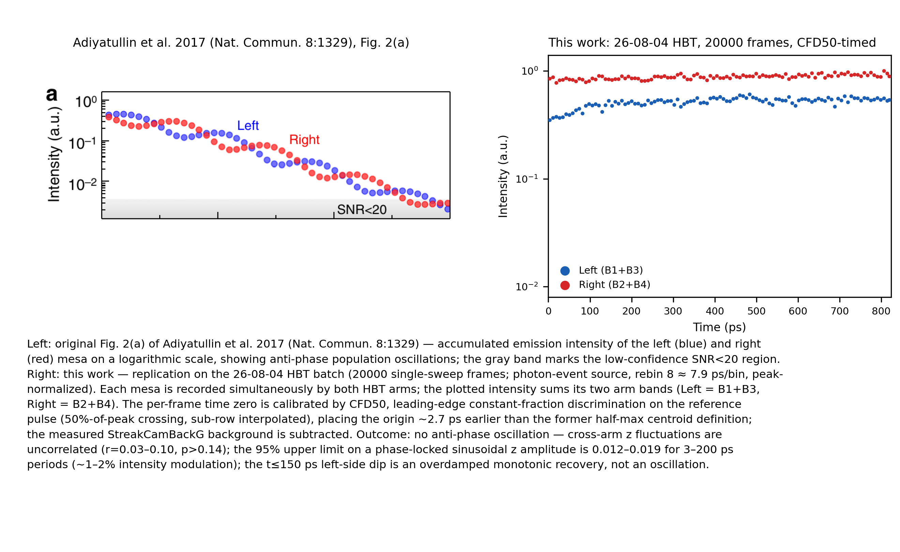
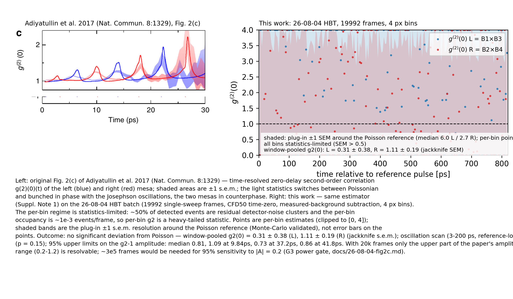

# Reproducing Adiyatullin et al. 2017 on single-sweep HBT data — project report

**Date:** 2026-08-10 · **Status:** reproduction campaign complete (null results, quantified) · **Audience:** collaborators / group meeting · **PDF:** [26-08-10-project-report.pdf](26-08-10-project-report.pdf) · **中文版：** [26-08-10-project-report-zh.md](26-08-10-project-report-zh.md)

This report closes the attempt to reproduce the two core measurements of
Adiyatullin et al., "Periodic squeezing in a polariton Josephson junction",
*Nat. Commun.* **8**:1329 (2017), on our own streak-camera data. It is organized as a
funnel: first what the data is (§2), how it is processed (§3), and how the
processing is checked and where its limits lie (§4–§5); then the reproduction result (§6),
the dynamics the data *does* contain (§7), and conclusions (§8). Validation records and
method comparisons are collected in the appendices.

## Bottom line up front

- **Instrument.** We built a single-sweep, photon-resolved Hanbury Brown–Twiss (HBT)
  analysis chain for streak-camera frames of a polariton Josephson dimer: per-frame
  time-zero from a laser reference pulse (constant-fraction discrimination, CFD),
  per-photon event extraction, spatial band pairing of the two condensates × two HBT
  arms, and the paper's own normally ordered g⁽²⁾ estimator. Every stage is checked on
  controlled inputs (§4).
- **Reproduction target.** The paper's Fig. 2(a) — anti-phase population alternation
  between the two condensates (the paper's mesas) at a ~10 ps period — and Fig. 2(c) —
  zero-delay g⁽²⁾ switching between Poisson (1) and bunched (>1) in step with that
  oscillation (§1).
- **Result.** Neither observable reproduces on our data — across two independent
  acquisition batches and two independent event curations. For the population
  observable the null is decisive: the upper limits sit far below the paper's
  full-contrast signal. For g⁽²⁾ the window-pooled statistic is Poisson-consistent in
  both arms, and any reference-locked oscillation is bounded below the top of the
  paper's amplitude range. All numbers: §6; one-figure summary: §8.
- **Checks behind the nulls.** The same chain recovers injected paper-type signals
  end-to-end; the decision criteria were registered before the data was analyzed; and
  the longer independent batch tightens every upper limit without changing any
  conclusion (§4, §6.3).
- **What the data does show.** The Josephson dynamics is present as *relative-phase
  winding*: tilted two-condensate interference fringes in the k-space synchroscan
  images, oscillating with a clean period in every recorded frame. In this
  detuned/running-phase regime the populations barely modulate — consistent with, not
  contradictory to, the real-space null (§7).
- **What it would take.** Covering the *lower* half of the paper's g⁽²⁾ amplitude
  range calls for a substantially longer acquisition — or, more effectively, a lower
  detector background (§5 quantifies the trade). The curated event tables and count
  cubes for both batches are archived and ready for the follow-up 2-D g⁽²⁾(t₁,t₂) and
  cross-condensate analyses (§8).

## 1. Introduction and the reproduction target

### 1.1 The physics in one paragraph each

**Polariton Josephson dimer.** Exciton-polaritons are light–matter quasiparticles in a
semiconductor microcavity; confined in two coupled circular mesas (2 µm diameter,
2.5 µm center spacing, tunnel coupling J = 0.4 meV in the paper's sample), two
condensates exchange population the way two coupled superfluids do: the population
imbalance z = (N_L − N_R)/(N_L + N_R) oscillates at a period set by the coupling
(~10 ps in the paper), damped by the polariton lifetime (5.2 ps). This is the
**Josephson oscillation** the paper images directly.

**HBT and g⁽²⁾.** A Hanbury Brown–Twiss setup splits the emission on a 50:50
beamsplitter and detects the two arms independently; the zero-delay second-order
correlation g⁽²⁾(0) = ⟨n₁n₂⟩/(⟨n₁⟩⟨n₂⟩) distinguishes Poissonian emission (g⁽²⁾ = 1)
from bunched emission (g⁽²⁾ > 1). Because the estimator is normally ordered and the two
arms dilute the same photon stream independently, arm-efficiency asymmetry cancels
exactly in the ratio — no arm calibration is needed. The paper's Fig. 2(c) reports
g⁽²⁾(0)(t) of each mesa switching between Poisson and bunched *in phase with the
Josephson oscillation*, the two mesas in anti-phase, with the bunching peaks growing
from ≈1.2–1.5 to ≳2 as the population decays.

**What the paper claims beyond that — and what we do not touch.** The paper's
Fig. 2(d)(e) squeezing curves are derived from a fitted model, not measured; intensity
bunching by itself is not a quadrature-squeezing measurement (that would need a
phase-locked local oscillator and balanced homodyne detection, which neither setup
has). This campaign reproduces the *intensity* and *intensity-correlation* measurements
only; we make no squeezing claim in either direction.

### 1.2 The target figures


*Paper Fig. 2(a): accumulated intensity of the left (blue) and right (red) mesa,
0–30 ps, log scale. Anti-phase alternation at ~10 ps period under a decaying envelope;
the gray band marks the SNR<20 region. Average over >3.9×10⁶ laser pulses.*


*Paper Fig. 2(c): g⁽²⁾(0)(t) of the two mesas (shaded ±1 standard error of the
mean, SEM) switching between Poisson and bunched in step with the population
oscillation, peaks growing with time.*

### 1.3 What "reproduction" means here

The paper's measurement facts (from its Supplementary Note 1): >3.9×10⁶ pulses over
34 h; custom photon counting on a synchroscan streak camera acting as the single-photon
detector for both HBT arms; time bins Δt = 1.296 ps = 2 detector px (0.648 ps/px);
per-pulse time jitter corrected with a split-off laser reference pulse (algorithm not
published); intensity per mesa I = n_L + n_R summed over arms; g⁽²⁾ from per-pulse
counts with SEM-propagated errors; 3.4 ps FWHM instrument resolution.

Our excitation regime is different: **nonresonant reservoir-fed condensates triggered
by an optical-Stark pulse**, imaged in real space over a 1 ns window, versus the
paper's resonant bonding/antibonding pulse and 30 ps window. We therefore replicate
the *measurement pipeline and the observable form*, on the closest observables our
platform produces, and we state regime differences as boundaries (§8) rather than
papering over them. Where the paper left method choices undocumented (time-zero
algorithm, photon threshold, background treatment, L/R mapping), we made our own and
checked them — the choices and their tests are listed in §3 and Appendix B.

**Datasets covered.** The campaign runs on the 26-08-04 HBT acquisition family: the
main batch plus a 3.6× longer supplement batch of the same condition.

## 2. Data: what the raw material looks like

### 2.1 Datasets

| Dataset | Content | Frames | Role |
|---|---|---|---|
| `26-08-04-hbt-time-reference`, main condition `hbt_condensate_josephson_regime` | single-sweep real-space HBT frames with laser time reference on the side | 20 000 (19 992 kept; 8 frames fail time-zero) | primary |
| same acquisition, 8 further conditions | synchroscan k-space / real-space images, no-pulse intensity calibrations, backgrounds, focus cross-sections, delay calibration | 10 each | calibration (the k-space condition drives §7) |
| supplement batch of the same HBT condition ("New folder (10)") | identical acquisition metadata except sweep length; signal ≈65 % of main batch | 72 000 (71 971 kept; 29 fail) | independent confirmation (§6.3) |

All frames are 1016 × 1344 px uint16 streak-camera images: the **vertical axis is
time** (1 ns over 1016 px ⇒ 0.984 ps/px, row 0 = window start, per the acquisition
metadata conventions in `metadata-conventions.toml`); the **horizontal axis is
uncalibrated detector pixels**. Raw MAT files are immutable; analysis reads
lossless derived HDF5 copies with per-frame provenance and SHA-256, pixel-exact
verified against the sources (supplement: 498 stratified frames, 0 mismatches).

### 2.2 Anatomy of the measurement


*Figure 3 (C1). (a) One realization: a single background-subtracted frame (sqrt
intensity scale). Emission arrives as sparse single-photon spots on a ~105 counts/px
pedestal; the bright laser reference pulse at the left edge provides each frame's time
origin — the cyan line marks the leading-edge 50 % crossing (CFD50, §3.3) that
defines it for this frame. (b) All 275 218 detected photon events of the main batch
after per-frame alignment: four vertical emission bands emerge. (c) Column profile of
the aligned events: the four bands B1–B4 and their pairing into Left = B1+B3 and
Right = B2+B4 (each condensate is imaged by both HBT arms; the 210 px B1↔B2 spacing
matches the 204 px real-space condensate spacing from the no-pulse calibration, and
the 430 px B1↔B3 spacing is the arm separation). The shaded windows are peak-core
integration windows, deliberately narrower than the full peak widths — the tails add
mostly residual noise (S/N optimization, Appendix B.1).*

Three structural facts matter for everything downstream:

1. **Four bands, two condensates, two arms.** On the single-sweep frames each
   condensate appears once per HBT arm, giving four emission bands; pairing them as
   L = {B1, B3},
   R = {B2, B4} reproduces the no-pulse real-space intensity ratio (0.586/0.579 per
   arm vs 0.578 calibration), while the cross pairing gives inconsistent ratios
   (0.59/1.51) and is rejected.
2. **A per-frame time reference.** The split-off laser pulse lands on the same frame
   (cols ~170–215, outside the detection columns). The sweep's two-state wander is
   ~13 ps rms — far larger than the analysis bin width — so per-frame alignment to
   this reference is not optional. The sample-pulse/reference-pulse delay was measured
   at 0.32 ± 0.20 ps, i.e. consistent with zero offset.
3. **A measured background.** A dedicated background condition (unexposed streak
   sweep) gives a per-pixel pedestal of ≈105 counts, subtracted frame-by-frame; its
   applicability to the supplement batch was verified directly (median off-signal
   difference +0.02 counts/px). What remains after subtraction is Poisson-like
   residual detector noise that also triggers the photon detector — quantified in §5.

## 3. From frames to physics: the measurement pipeline

The pipeline's job is to turn 20 000 raw camera frames into the two observables of
§1.2: the accumulated per-condensate intensity traces (the Fig. 2(a) analog) and the
per-condensate zero-delay g⁽²⁾(0)(t) (the Fig. 2(c) analog). Two properties of the
data dictate its shape:

- **The signal is sparse single-photon emission on a large detector pedestal.** The
  background must therefore be *measured*, not fitted, and the photon detector must
  be kept free of model assumptions wherever possible.
- **The time base wanders.** The streak sweep's origin drifts by ~13 ps rms from
  frame to frame — far wider than any analysis bin — so every frame must be
  re-referenced to the laser pulse recorded on that same frame before any
  accumulation makes sense.

The chain has eight stages:

1. **Conversion** — MATLAB exports to verified HDF5 frames.
2. **Background subtraction** — remove the measured per-pixel pedestal.
3. **Per-frame time zero** — CFD50 timing on the reference pulse.
4. **Photon-event detection** — one event per photon via bright-component finding.
5. **Band windows and pairing** — locate the four emission bands; assign bands to
   condensates.
6. **Products** — accumulated traces, a curated event table, count cubes.
7. **The g⁽²⁾ estimator** — cross-arm coincidences with background correction.
8. **Statistical policy** — the power gate and pre-registered decision criteria.

The subsections below state, for each stage, what is done and the physical reason
behind it. How each stage is *checked* on controlled inputs is the subject of §4,
with the full records in Appendix A; the rejected alternatives, and what would change
under them, are compared in Appendix B.

### 3.1 Conversion and provenance

The raw material is MATLAB v7.3 export files. Conversion copies only the
streak-camera payload into per-experiment HDF5 files (schema 2), recording per-frame
provenance and verifying the copy pixel-exactly against the source (volumes and
checksums: §2.1). The raw files are never touched by any analysis step.

*Why.* Two guarantees are cheap at this stage and impossible to retrofit: the raws
stay immutable, and every derived number traces back to a hashed source frame.

### 3.2 Background subtraction

Each frame carries a per-pixel pedestal of ≈105 counts (the unexposed streak level),
measured in a dedicated background condition and subtracted frame-by-frame. The same
measurement applies to the supplement batch; that was verified directly on the data
(median off-signal difference +0.02 counts/px, §2.2).

*Why.* The pedestal is large compared to single-photon spots, so detection on
un-subtracted frames would measure pedestal shape, not photons. Using the *measured*
background rather than a fitted model keeps model bias out of the photon detector.
Subtraction removes the pedestal's level but not its fluctuation: a Poisson-like
residual detector noise remains, which also triggers the photon detector. This
residue is not a detail — §5 shows it is 45–55 % of in-band events and the
second-largest error lever of the whole measurement.

### 3.3 Per-frame time zero: CFD50

Part of the excitation laser is split off and lands on the same frame (columns
~170–215, outside the detection columns), giving each frame its own time reference.
The time zero t0 is the row where the reference pulse's leading edge crosses 50 % of
its peak height, interpolated to sub-row precision — a constant-fraction discriminator
(CFD), the standard timing answer to amplitude walk (shot-to-shot height variation)
and pulse-shape breathing (width variation). The delay between sample pulse and
reference pulse was measured at 0.32 ± 0.20 ps — consistent with zero — so no offset
correction is applied. Frames whose reference pulse fails a signal-quality cut are
excluded and recorded: 8 of 20 000 (0.04 %) in the main batch, 29 of 72 000 in the
supplement.

*Why.* Without per-frame re-referencing, the 13 ps two-state wander would smear every
time structure over many analysis bins. And the estimator must be constant-fraction
because the reference pulse's shape breathes: a centroid or fixed-threshold crossing
tracks that breathing and inherits it as timing error (+2.7 ps mean bias, 1.3 ps
per-frame scatter — measured in Appendix B.2), while the 50 %-of-peak crossing is
immune by construction. The end-to-end injection test of §4 confirms it on ground
truth: CFD50 is unbiased at −0.10 ± 0.33 px (0.32 ps), far below the 4 px analysis
bin.

### 3.4 Photon-event detection

Within detection columns 350–1150, the detector finds 8-connected bright
components — contiguous blobs of pixels above threshold — keeps those with integrated
post-background amplitude ≥ 25 counts and size ≥ 2 px, and reduces each to a
count-weighted sub-pixel centroid. The 25-count threshold sits at the knee of a
sensitivity scan.

*Why.* One photon does not light one pixel: it triggers a multi-pixel charge cloud on
the microchannel-plate (MCP) intensifier. Integrating each cloud back into one
component recovers one event per photon, and the centroid restores sub-pixel
position. The resulting localization error is 0.16–0.17 px RMS per axis (§5,
Appendix B.3) — irrelevant under the 1–4 px analysis binning.

### 3.5 Band windows and pairing

The four emission bands of §2.2 are located on the column histogram of detected
photon events: the histogram is folded into 10-px sub-windows, the baseline and its
σ are taken from the lowest-40 % sub-windows, and bands are the contiguous runs above
baseline + 5σ, with gap bridging at baseline + 2σ. This is a pure count-threshold
rule — no profile fitting. It runs on the *event* histogram rather than the analog
intensity profile for a concrete reason: the event histogram's out-of-band floor is
flat Poisson and therefore thresholdable, while the analog profile sits on a lumpy
fixed-pattern baseline that no σ-rule can threshold cleanly (Appendix B.1).

The resulting windows are B1 = 380–450, B2 = 570–680, B3 = 810–880, B4 = 1010–1110
px. They are deliberately peak-*core* integration windows, narrower than the full
peak widths: away from a band center the signal density falls while the
residual-noise density stays flat, so the tails contribute mostly noise. Width scans
of S/√(S+N) place these windows within 0.6 % of the signal-to-noise optimum
(Appendix B.1). Finally, the bands are paired into condensates —
Left = {B1, B3}, Right = {B2, B4} — per the geometry checks of §2.2: the B1↔B2
spacing matches the calibrated condensate spacing, the B1↔B3 spacing matches the arm
separation, and only this pairing reproduces the no-pulse intensity ratio.

### 3.6 Products: traces, event table, and count cubes

A single detection pass produces everything the analysis consumes, in three
synchronized products:

- **Accumulated traces.** Per band, mean and SEM intensity versus time after sub-row
  alignment to the per-frame time zero — in two parallel sources: *photon* (event
  counts) and *analog* (integrated counts). These feed the population observable of
  §6.1.
- **Event table.** A curated per-photon list — frame, sub-pixel x/y,
  jitter-corrected τ = y − t0, amplitude: 275 218 events in the main batch,
  661 090 in the supplement. This is the archival form for the follow-up analyses of
  §8.3.
- **Count cubes.** (frames × 4 bands × time-bin) count arrays at 1/2/4 px binning —
  the direct input of the g⁽²⁾ estimator.

Because table and traces come from *one* pass, their consistency is checkable
mechanically: every extraction ends with an automatic table→traces reconstruction
test (integer counts must rebuild the traces; tolerances and records in
Appendix A.5).

### 3.7 The g⁽²⁾ estimator

For each condensate, the estimator correlates its two bands *across the HBT arms* per
time bin: L as B1×B3, R as B2×B4. Each pairing correlates a condensate with
*itself* — after the 50:50 beamsplitter the two arms are two independent copies of
the same emission — so L and R are the auto-correlations of the left and right
condensate respectively. A condensate-1×condensate-2 cross-correlation carries
different physics and does not enter this report; the products are archived for it
(§8.3).

Per time bin, g⁽²⁾(0) is the paper's normally ordered ratio of the per-frame counts
n₁, n₂ in the two arms, g⁽²⁾(0) = ⟨n₁n₂⟩/(⟨n₁⟩⟨n₂⟩), averaged over frames. Because
the ratio is normally ordered and the two arms dilute the same photon stream
independently, the (unequal, unknown) arm efficiencies cancel exactly — no arm
calibration is needed (§1.1).

The residual detector noise enters every term of the ratio and is corrected, not
ignored. Its expected count per band and bin, β, is measured from out-of-band events
in the same time bin (the out-of-band density is flat in τ, χ²/ndf = 1.16,
Appendix A.1); the estimator subtracts β from the per-arm means and the matching
product terms from the coincidence moment, which removes the noise contribution
without bias. What subtraction cannot remove is the extra counting variance the noise
adds — that cost is irreducible on the analysis side and is carried into §5's error
budget.

Two error bars appear in §6 because two different questions are asked. The per-bin
*displayed* band is a null-analytic ("plug-in") SEM: at ~10⁻³ occupancy per bin, a
single bin's Gaussian error bar is meaningless, so the band instead shows the
experiment's resolution around the Poisson line — it answers "could a deviation have
been seen here?". The *window-pooled* value answers "is the average g⁽²⁾ Poisson?"
and uses a leave-one-frame-out jackknife SEM, Monte-Carlo-calibrated in
Appendix A.3.

### 3.8 Statistical policy: the power gate and pre-registration

Two rules were fixed **before the real-data g⁽²⁾ was ever computed**:

- **The power gate.** From the measured band rates and residual-noise density,
  compute what the dataset can resolve *before* running the estimator: per-bin SEMs,
  pooled precision, oscillation sensitivity versus period. The gate's verdict was
  "borderline" — only the upper half of the paper's amplitude range is covered
  (§5) — and the pre-agreed consequence was that the deliverable degrades from a
  detection claim to an upper-limit report. §6 is that report.
- **Pre-registered decision criteria.** The four science tests (bunching existence,
  oscillation, anti-phase, envelope growth), their statistics, surrogate null
  constructions, and significance thresholds were written down on 2026-08-06, ahead
  of the computation (Appendix A.1). Any positive result would additionally have had
  to survive injection recovery (§4); none was triggered.

*Why.* A null is only informative if the criteria were not tuned to the data after
the fact. The power gate makes the null *quantitative* in addition — it turns "we see
nothing" into "nothing above this amplitude exists", the UL95 numbers of §6.

## 4. Recovery of known signals

The check on the chain above is whether it recovers signals we planted — end-to-end,
from synthetic frames through the untouched production code.


*Figure 4 (C2). Left: end-to-end recovery of an injected anti-phase population
oscillation (period 9.84 ps — the paper's Josephson period — z amplitude 0.5, locked to
the true per-frame time zero) in synthetic frames that carry **measured** reference-pulse
shapes with their real frame-to-frame breathing, the measured background level, and the
observed two-state time-base wander. Top: the recovered z(t) oscillates at 9.87 ps with
the expected (noise-diluted) amplitude. Bottom: per-frame time-zero error — CFD50 is
unbiased (−0.10 ± 0.33 px); the former centroid estimator is biased +2.71 px with
1.25 px scatter because it tracks the pulse-shape breathing, which is why the pipeline
uses CFD50. Right: cube-level g⁽²⁾ injection — a paper-style modulation (9.84 ps,
anti-phase, growing envelope) added to the real measured rates and residual background:
the ensemble amplitude bias stays within the pre-set 10 % acceptance criterion at both
injection strengths; the single-replica detection rate at paper strength (L 19 %,
R 50 %) is the direct empirical reading of the power gate's "borderline" verdict (§5).*

Three complements, detailed in the appendices:

- **Frame-level injection through the curated "dataset A" chain** (real event patches
  planted into real frames): 98.8–99.6 % of injected blobs survive curation with zero
  time-zero perturbation, and the injected 9.84 ps modulation is recovered at the
  expected amplitude (Appendix A.4).
- **Estimator bias checks on synthetic inputs**: on synthetic Poisson cubes the
  g⁽²⁾ estimator returns 1 within Monte-Carlo tolerance, and the analytic SEMs match
  64-replica Monte Carlo within 4 % at the working bin width (Appendix A.3).
- **Robustness to method choices**: the conclusions are identical under the
  alternative time-zero estimator, under the alternative (four-Gaussian) band-window
  semantics, and under the alternative (global-mean) background model — each comparison
  is quantified in Appendix B.

## 5. Error analysis and resolving power

Knowing precisely what the measurement *cannot* see is what makes the nulls of §6
informative. The error budget decomposes as follows (numbers for the main batch;
the supplement scales accordingly).

**Event localization** (from a synthetic-spot injection study on the same streak
camera, `DOCS/peak-localization-error.md`): 0.16–0.17 px RMS per axis, dominated by a
deterministic sub-pixel window-truncation bias (0.13 px), not by detector noise
(0.002 px); spot-recovery completeness 92 %. Irrelevant under the 1–4 px analysis
binning.

**Time-zero.** Per-frame sweep wander is 13.2 ps rms (two-state, real synchroscan
behavior — the two timing estimators agree on it to 0.1 ps). After CFD50 alignment the
residual estimator noise is 0.33 px ≈ 0.32 ps, far below the 4 px (3.94 ps) g⁽²⁾ bin.

**Statistical budget for g⁽²⁾.** In the coincidence-counting limit,

SEM[g⁽²⁾(0)] ≈ 1/√(F·s₁·s₂) × 1/√(purity₁·purity₂),

with F frames, per-arm signal rate s, and purity = signal/(signal+noise). Measured:

| factor | value | consequence |
|---|---|---|
| frames F | 19 992 (main) / 71 971 (supplement) | SEM ∝ 1/√F |
| signal rate s | 0.50–1.21 events/frame/arm (0–820 ps) | quadratic lever |
| residual detector noise | **45–55 % of in-band events** | SEM ×2.0–2.3 ⇔ losing 4–5× frames |
| bin width × period | sinc penalty 1.32× at 9.84 ps, ≈1 at 74.4 ps (4 px bins) | harmless at our (longer) periods |
| time-zero residual | 0.32 ps | negligible |

The noise fraction is the second-largest lever and has **no analysis-side remedy** —
signal and noise events are the same MCP-cloud objects (amplitude/size distributions
coincide; the best per-event discriminator achieves 1.7:1 against a 3:1 break-even),
raising the detection threshold 25→70 counts removes 11 % noise at 6 % signal cost, and
narrowing the windows gains 1–4 %. Only acquisition-side background reduction helps —
and it helps quadratically, noise halving ≈ frames doubling.

**Resolving power vs the paper.** The figure below is the measurement's frequency-
dependent 95 % sensitivity floor, computed from measured rates before the estimator
ever ran (the power gate), Monte-Carlo-verified:


*Figure 5 (C3). Minimum resolvable reference-locked g⁽²⁾ oscillation amplitude (95 %)
vs period for 1/2/4 px bins; gray band = the paper's Fig. 2(c) amplitude range
(g⁽²⁾−1 ≈ 0.2–1.2). The 4 px width passes Monte-Carlo validation for both arms and is
the working width. The dataset covers the upper half of the paper's range.*

Frame-count outlook at current rates (4 px, anti-phase-combined median / at 9.84 ps):
20 k frames → 0.78 / 1.01 (measured: 0.81 / 1.09 — the gate was accurate);
72 k → 0.41 / 0.53; 92 k pooled → 0.36 / 0.47; **≈3×10⁵ frames → 0.20 / 0.26**,
covering the paper's lower bound.

## 6. The reproduction result

With the pipeline's limits quantified, here is what it measures on the real data.

### 6.1 Population dynamics: no anti-phase alternation



*Figure 6 (C4). The paper's Fig. 2(a) (left) vs this work (right): accumulated Left
(B1+B3, blue) and Right (B2+B4, red) intensity, log scale, peak-normalized, 19 992
frames. The traces are flat; the early (t ≲ 150 ps) left-side dip is a monotonic
overdamped recovery, not an oscillation. The paper's full-contrast anti-phase
alternation is absent. (The panel's baked-in caption quotes the scan as 0.008–0.019,
median 0.012 — the definitive values are those in the text below.)*

Quantitatively, on z = (I_L − I_R)/(I_L + I_R):

- Cross-arm detrended-fluctuation correlations are insignificant (r = 0.030,
  permutation p = 0.525; r = 0.095, p = 0.145 at two binnings).
- A reference-locked sinusoid scan over 3–200 ps periods gives a 95 % upper limit on
  the z amplitude of **0.0123 median / 0.0193 worst** — i.e. ≈1–2 % intensity
  modulation, against the paper's full-contrast measured signal (z ≈ ±0.4–0.5).
  Targeted fits at the
  a-priori periods: 9.84 ps |A| = 0.0041 (UL95 0.0116); 74.4 ps 0.0038 (0.0113);
  83.7 ps 0.0090 (0.0165).
- The most sensitive direct look — subtracting each arm's mean and magnifying the
  plateau fluctuations with ±1 SEM bands
  ([offset-zoom figure](../analysis/26-08-04-derived-hbt-time-reference/fig2a_offset_zoom.png)) —
  finds the bands overlapping everywhere and a weak **positive** common-mode correlation
  (r = +0.174, p = 0.023): slow shared drift, the opposite sign from anti-phase.


*The scan behind these numbers: fitted z-oscillation amplitude and its |A|+2σ 95 %
upper limit vs period (left, log scale), and the detrended combined z(t) with its
±1 SEM band (right). No period stands out; the upper limit stays at the 1–2 % level
everywhere.*

### 6.2 Photon statistics: Poisson-consistent, no bunching switching



*Figure 8 (C5). The paper's Fig. 2(c) (left) vs this work (right): g⁽²⁾(0)(t) of each
condensate (L = B1×B3 blue, R = B2×B4 red), 4 px bins; the shaded band is the experiment's
resolution (plug-in SEM, §3.7) around the Poisson line. The curve is statistics-limited
per bin by construction; the information is in the pooled value and the oscillation
limits.*

- **Window-pooled g⁽²⁾(0)** (0–820 ps, 4 px, jackknife): **L = 0.310 ± 0.380**,
  **R = 1.114 ± 0.188** — z = −1.82 / +0.60, both consistent with Poisson (|z| < 2,
  pre-registered threshold).
- **The four pre-registered tests** (criteria fixed 2026-08-06, before the computation;
  200 circular-shift surrogates): (a) no significantly bunched/antibunched bin
  (p = 0.32 / 0.86); (b) no significant reference-locked oscillation (combined
  p = 0.15) — 95 % upper limit **0.812 median** over 3–200 ps, 1.086 at the paper's
  9.84 ps period, 0.680 / 0.540 at the measured k-space periods 74.4 / 83.7 ps;
  (c) no anti-phase — the detrended L/R correlation is weakly *positive*
  (r = +0.100, p = 0.886 one-sided), mirroring §6.1's common-mode drift;
  (d) no envelope growth (late-minus-early pooled g⁽²⁾−1: L +0.159, p = 0.45;
  R +0.176, p = 0.37).

### 6.3 An independent batch and an independent curation say the same thing

**Supplement batch** (71 971 frames, same condition, acquired back-to-back; analyzed
stand-alone because its signal rate is ≈65 % of the main batch): the same flat traces
(anti-phase UL95 median **0.0084**), pooled g⁽²⁾(0) L = 1.304 ± 0.320 /
R = 0.990 ± 0.117 (Poisson-consistent), all four pre-registered tests null, oscillation
UL95 median **0.496**. Every limit tightened; every conclusion held
([fig2a](../analysis/26-08-04-derived-hbt-time-reference/fig2a_replica_supplement.png) /
[fig2c](../analysis/26-08-04-derived-hbt-time-reference/fig2c_replica_supplement_bin4px.png)
supplement panels).

**Dataset A** — a curated re-extraction keeping only events that can physically be
condensate signal (in-band, off the one defective column, not touching frame edges;
161 357 of 275 218 events kept in the main batch, verified as an exact subset), with a
per-band local noise floor replacing the global-mean β: identical conclusions with
tighter limits (population UL95 0.0131, 0.0226 after noise-dilution correction;
g⁽²⁾ oscillation UL95 median 0.58; and for the supplement's dataset A: population
UL95 0.0083, g⁽²⁾ oscillation UL95 median 0.488), and better
paper-strength injection detection (L 31 % / R 81 %) from the purer noise model.

The nulls persist across the pipeline variant, the window choice, and the noise model —
in everything tried here, they follow the data.

## 7. The dynamics we do see: phase winding in k-space

The oscillation the collaborators expect is present in the apparatus — just not as
real-space population modulation.


*Figure 9 (C6). Synchroscan k-space images (camera-internal accumulation, hence immune
to the per-frame time-base wander): the two-condensate interference pattern forms a
tilted checkerboard — fringes that tilt with time are a relative phase that winds with
time. A fixed-k column oscillates with main period **74.4 ps** (9 of 10 k-bins;
secondary 83.7 ps), visible in each of the 10 frames individually (2-D FFT peak/median
11–18). The no-pulse k-space calibration shows only the smooth static emission
envelope — no fringe pattern — excluding a detector origin of the fringes;
74.4 ps ≈ 13.4 GHz is far above known electronics pickup.*

Phase winding with barely-modulated populations is the signature of a detuned,
running-phase Josephson regime — exactly the regime in which a Fig. 2(a)-type
*population* observable stays flat. The k-space measurement and the real-space null
are two views of the same state, and they agree. Resolving the phase dynamics at the
single-sweep level would need per-frame k-space imaging or per-frame likelihood
analysis — a different acquisition, listed in §8.

## 8. Conclusions


*Figure 10 (C7). All quantitative conclusions in one view. Top: population-oscillation
95 % upper limits (z-space) for the two batches and the two curations, against the
paper's full-contrast band. Middle: g⁽²⁾ oscillation 95 % upper limits against the
paper's amplitude range. Bottom: window-pooled g⁽²⁾(0) with ±1 SEM against the Poisson
line. Every upper limit sits far below the corresponding paper signal; every pooled
value sits on Poisson within error.*

### 8.1 Claim-by-claim account

| Paper claim (observable) | This work | Verdict | Evidence |
|---|---|---|---|
| Fig. 2(a): anti-phase population alternation, ~10 ps, full contrast (measured z ≈ ±0.4–0.5) | flat traces; UL95 1.2 % (main) / 0.8 % (supplement) / 2.3 % (dataset A, dilution-corrected) of z | **Not reproduced — decisive** (paper signal ≳30× above limits) | §6.1, Fig. 6 |
| Fig. 2(c): g⁽²⁾(0)(t) switches Poisson↔bunched in phase with the oscillation, peaks 1.2→≳2 | pooled Poisson-consistent; oscillation UL95 0.81 / 0.50 / 0.58 / 0.49 by batch/curation; four pre-registered tests null | **Not reproduced within sensitivity** (limits cover the paper range's upper half) | §6.2, Fig. 8 |
| Anti-phase between the two condensates (both observables) | weak *positive* common-mode correlation in both (r = +0.17 intensity; r = +0.10 g⁽²⁾) | **Not reproduced; sign opposite** | §6.1–6.2 |
| Bunching-envelope growth with time | late−early differences consistent with zero | **Not reproduced** | §6.2 (d) |
| Josephson dynamics exists in the device | confirmed — as 74.4 ps relative-phase winding in k-space, populations unmodulated | **Confirmed, different quadrature** | §7, Fig. 9 |

### 8.2 Boundaries (what this campaign does not say)

1. Different physical regime: resonant pulsed bonding/antibonding excitation, 30 ps
   window (paper) vs nonresonant reservoir-fed + Stark kick, 1 ns window (this work).
   We replicated the measurement pipeline and observable form, not the identical state.
2. g⁽²⁾(0) > 1 would not have been quadrature squeezing anyway; the paper's
   Fig. 2(d)(e) squeezing curves are model-derived and were never in scope.
3. "In phase with Josephson oscillations" can only be referenced to the laser
   reference pulse here, since the population oscillation itself is absent in real
   space.
4. The two batches differ physically (signal rate, L/R ratio) and were analyzed
   stand-alone, not pooled.
5. Nothing here bears on the single-kick trajectory question (per-frame/hierarchical
   analysis) — it remains open by design.

### 8.3 What comes next

- **2-D g⁽²⁾(t₁,t₂)** (the paper's Fig. 3) and **cross-condensate** LR/RL correlations:
  the event tables and count cubes of both batches are already archived for exactly
  this.
- **Statistics**: ≈3×10⁵ frames at current rates cover the paper's lower g⁽²⁾ bound;
  halving the detector background is worth ≈2× frames (acquisition-side only).
- **Phase dynamics at single-sweep level**: per-frame k-space imaging or per-frame
  likelihood analysis, motivated by §7.
- **Open metrology gap**: the absolute row→ps calibration is metadata-based; an
  in-data calibration remains a to-do (it does not affect any conclusion here — all
  periods are measured in-frame).

**Declaration.** The reproduction campaign against Adiyatullin et al. 2017 Fig. 2(a)
and Fig. 2(c) is **complete**: both observables were measured on two independent
batches and two curations with a pipeline whose every stage was checked on controlled
inputs (§4, Appendix A); the results are null with quantified upper limits; the
instrument's resolving power is known and its shortfall against the paper's lower
amplitude range is quantified with a concrete remedy.

---

## Appendix A. Validation records

### A.1 Pre-registration and the power gate

- The four science tests (bunching existence, oscillation, anti-phase, envelope
  growth), their statistics, surrogate construction, and significance thresholds were
  written into `DOCS/26-08-04-fig2c.md` §G6 on **2026-08-06, before any real-data
  g⁽²⁾ computation**. Deviating from Poisson requires |z| ≥ 2 (pooled) or
  surrogate-calibrated p < 0.05 (tests).
- The **power gate** (G3) ran before the full pipeline: from the measured band rates
  and the measured out-of-band residual-noise density (flat in τ, χ²/ndf = 1.16) it
  predicted per-bin SEM medians, the pooled precision (L ±0.41 / R ±0.18 — measured
  jackknife: 0.38 / 0.19), and the oscillation sensitivity (median 0.78 — measured
  0.81). Its "borderline" verdict (only the upper half of the paper's 0.2–1.2 range
  covered) triggered the pre-agreed downgrade to an upper-limit deliverable, confirmed
  with the user on 2026-08-06. The supplement batch's gate passed the same way
  (predicted 0.52, measured 0.50).

### A.2 Surrogate null distributions

One arm's per-frame counts are circularly shifted by a random frame offset, breaking
same-frame coincidences while preserving each arm's rate structure and the t0
structure; 200 surrogates pass through the identical statistic pipeline. Multiplicity
across bins/periods is controlled by taking scan-maximum statistics (max|z|, max|A|/σ)
on both data and surrogates.


*The oscillation test at the working 4 px width: fitted |A| scans for both pairs and
the anti-phase combination with the combined UL95 curve (left; dotted marks at the
a-priori periods 9.84 / 74.4 / 83.7 ps), and the observed scan-maximum statistic
against its surrogate null distribution (right; p = 0.154).*

### A.3 Monte-Carlo calibration of the analytic errors

64 synthetic Poisson replicas through the estimator chain: at the working 4 px width
the analytic UL95 agrees with MC within 4 % for both pairs (ratios 1.04/1.01 — pass);
2 px passes for R (1.03) but not L (1.54 — heavy-tailed; used qualitatively only);
1 px fails (spike-dominated). Pooled jackknife SEMs sit within 0.86–1.07 of MC.
Supplement: 4 px and 2 px ratios within [1.000, 1.024]; 1 px L fails identically.
This calibration is why 4 px is the reporting width throughout.

### A.4 Injection record (full)

| test | injected | recovered | verdict |
|---|---|---|---|
| fig2a-style frame-level, real reference shapes (1500 synthetic frames) | z = 0.5 anti-phase, 9.84 ps | period 9.87 ps; t0 bias −0.10 px, std 0.33 px; amplitude at the noise-diluted expectation | pass (<2 % period error) |
| fig2c-style cube-level, strong (peak g⁽²⁾−1 = 6→8), 16 replicas | 9.84 ps anti-phase, growing envelope | ensemble bias L −4.5 %, R −9.0 %; period within 2 %: L 11/16, R 16/16; all replicas significant | pass (<10 % bias) |
| fig2c-style cube-level, paper strength (1.5→2), 16 replicas | same | ensemble unbiased (L +4.1 %, R −5.6 %); single-replica detection L 19 %, R 50 % | unbiased; partial detection = the borderline regime |
| supplement cube-level | same protocols | strong: L +0.2 %, R −4.1 %; paper: L −7.4 %, R +4.3 %, detection L 19 %, R 81 % | pass |
| dataset A cube-level | same | strong: L −2.2 %, R −7.9 % (main), L −9.2 %, R −4.6 % (supplement); paper-strength detection L 31 %, R 81–100 % | pass; purity gain converts to detection rate |
| dataset A frame-level (real frames + 394 real event patches) | z-mode: 10 867 blobs in 2856 frames; bunching-mode: 252 blobs (126 cross-arm pairs) | retention 98.8 % / 99.6 %; zero t0 perturbation; recovered amplitudes match the dilution expectation within 10 % | pass |

### A.5 Extraction self-consistency

Event table and fig2a traces issue from a single detection pass; every full extraction
ends with an automatic table→traces reconstruction check (integer-count criterion
≤2 counts/bin from float64 bin-edge ties: main batch [1,1,1,2] counts across the four
bands — pass; supplement 14–39 counts/band = 0.015–0.044 % of band events, tolerance
scaled accordingly — pass). Time-zero failures are excluded and recorded (main: frames
3543, 4458, 4589, 6614, 7935, 8190, 9765, 11225; supplement: 29 frames, 0.04 %).

## Appendix B. Method comparisons

These comparisons justify each production choice; none of them changes a conclusion.

### B.1 Band-window determination

Production method (since 2026-08-05): locate bands on the **photon-event column
histogram** (the out-of-band floor is flat Poisson; the analog profile's fixed-pattern
baseline is not thresholdable), folded into 10-px sub-windows; baseline and σ from the
lowest-40 % sub-windows; bands = runs above baseline+5σ with baseline+2σ gap bridging;
runs touching the detection-column edge are discarded as truncation artifacts.

- **vs a four-Gaussian attribution rule.** The windows come from the count-threshold
  rule above, not from a fit. For width reference, a constant-background +
  four-Gaussian fit of the main-batch histogram converges to
  μ = 415.9/623.7/845.0/1061.2 px (≤1.5 px from the window centers), σ ≈ 34.5–37.9 px;
  the production windows are ≈ μ±(1.0–1.45)σ of these peaks — peak-core *integration*
  windows. A μ±2σ attribution-style rule would instead give 170–190 px windows
  (2–3× wider) and push the residual-noise fraction above 50 %.
- **S/N optimality.** Width scans of S/√(S+N) place the production windows within
  0.6 % of optimum (a later all-rows refinement: ~1 % for B2/B4, ~6–7 % for the
  narrower B1/B3 — the basis of the fdr-snr recommendation, not a retroactive change).
- **The 8-method study** (`DOCS/26-08-08-band-window-methods.md`): eight candidate
  detectors × both batches, plus parameter-plateau, growth-curve, and synthetic-shelf
  benchmarks, recommend a local-floor Poisson-FDR detection + S/N-optimal width
  ("fdr-snr") as the future default; it reproduces the manually-set supplement windows
  without hand-tuning (FOM within 0.1 %). The study also dissected the production
  method's supplement failure: B1's over-threshold run touches detection column 350 and
  the truncation filter discards the whole band (a 2026-08-10 rerun with the edge moved
  to 330 confirmed the pile-up follows the boundary — the method, not the edge
  position). Both batches' finalized windows predate the study and stand unchanged.
- **Conclusion stability:** every downstream result was re-checked under the
  alternative window semantics where applicable (§6.3 dataset A uses S/N-optimal
  windows) — conclusions unchanged.

### B.2 Time-zero estimator

Centroid vs CFD50 on all 19 992 paired frames: centroid − CFD50 = +2.78 px
(+2.73 ps) mean — the centroid is dragged late by the pulse's heavy tail — with
1.37 px (1.34 ps) per-frame scatter from shape breathing. The injection experiment
(§4) shows the same numbers against ground truth (CFD50 −0.10 ± 0.33 px; centroid
+2.71 ± 1.25 px) and that the recovered oscillation period is unaffected. The null
result was explicitly re-verified under the centroid variant (UL95 0.013–0.020 vs
0.012–0.019). CFD50 is the production choice on principle (constant-fraction timing is
the correct answer to amplitude/shape walk) plus this evidence.


*Centroid vs CFD50 on all 19 992 paired frames: the per-frame estimator difference
(mean +2.73 ps, std 1.34 ps) is stable across the full acquisition.*

### B.3 Event localization

Production: trackpy (Crocker–Grier) count-weighted centroid, diameter 7, minmass 300.
Against circular 2-D Gaussian fits on 1 518 peaks from the same detector study
(`DOCS/peak-localization-error.md`): 92.2 % agree within 0.2 px, median 0.052 px, no
systematic offset; Gaussians fail on non-Gaussian elongated MCP clouds (edge
collisions), centroids do not. Error budget in §5.

### B.4 Residual-noise model and dataset A

Old pipeline: β from the **global** mean out-of-band density. Investigation showed the
noise floor is a stable fixed pattern in x (block correlation 0.97), so a global mean
misestimates per-band floors by ±30–50 %. Dataset A uses **per-band local-linear
floors** (35 px fit windows, 30 px guard bands against the measured 25–30 px signal
tails; B1 one-sided toward the detection edge), ≈20 % lower on average; floor variants
bracket the systematic. Effect on the headline numbers: pooled g⁽²⁾(0) L 0.531
(local) vs 0.307 (global) — the bracket is smaller than the ±0.38 statistical error —
and the old-global variant reproduces the pre-curation numbers nearly bitwise,
confirming the estimator chain. Curation itself: out-of-band, defective-column (main:
col 676; supplement: 11 hot columns), and frame-edge-touching events removed;
morphology cuts were evaluated and rejected (signal and noise are the same MCP-cloud
objects; best discriminator 1.7:1 vs 3:1 break-even).

### B.5 What does not help

Raising the detection threshold (25→70 counts): −11 % noise at −6 % signal, figure of
merit unchanged. Narrowing the band windows around the cores: 1–4 % gain. Both probed
on 500-frame / sub-window studies; the only effective lever is acquisition-side
background reduction (§5).

## Appendix C. Reproduction commands

Each stage's full command set lives in its execution document (Appendix D):
conversion (`DOCS/data.md`, derived-directory READMEs), fig2a pipeline
(`DOCS/26-08-04-fig2a.md` §复现), fig2c pipeline incl. power gate / science tests /
injection (`DOCS/26-08-04-fig2c.md` §复现), supplement batch
(`DOCS/26-08-06-hbt-supplement.md` §复现), dataset A (`DOCS/26-08-08-dataset-a.md`).
The report figures are regenerated from the worktree root with:

```powershell
.\.venv\Scripts\python.exe analysis\26-08-10-project-report\render_report_data_preview.py
.\.venv\Scripts\python.exe analysis\26-08-10-project-report\render_report_injection.py
.\.venv\Scripts\python.exe analysis\26-08-10-project-report\render_report_summary.py
.\.venv\Scripts\python.exe `
  analysis\26-08-04-derived-hbt-time-reference\measure_kspace_fringe_oscillation.py `
  --h5 <derived H5> --out analysis\26-08-10-project-report\figures\fig_kspace_fringe.png
```

The PDF version (`DOCS/26-08-10-project-report.pdf`) is built from the worktree root
with pandoc + XeLaTeX; all engine/font/filter settings live in
`analysis/26-08-10-project-report/pdf_build.yaml` (Cambria covers the Greek/symbol
inventory, Microsoft YaHei the two CJK anchor characters above, and a Lua filter lets
long code spans wrap inside table cells):

```powershell
pandoc docs\26-08-10-project-report.md -o docs\26-08-10-project-report.pdf `
  --defaults=analysis\26-08-10-project-report\pdf_build.yaml
```

## Appendix D. Sub-report index

| document | role in this report |
|---|---|
| `DOCS/adiyatullin2017-fig2a.md` / `adiyatullin2017-fig2c.md` | paper-side fact archive + target decomposition (G-criteria) — §1 sources |
| `DOCS/26-08-04-fig2a.md` | fig2a pipeline, band windows, null + sensitivity — §3, §6.1 |
| `DOCS/26-08-04-fig2c.md` | power gate, pre-registered tests, upper-limit report — §3.8, §6.2, App. A |
| `DOCS/26-08-06-hbt-supplement.md` | 72 000-frame supplement batch — §6.3 |
| `DOCS/26-08-08-dataset-a.md` | dataset A curation + downstream re-analysis — §6.3, App. B.4 |
| `DOCS/26-08-08-dataset-a-noise-model.md` | noise-floor structure — §5, App. B.4 |
| `DOCS/26-08-08-band-window-methods.md` | 8-method band-window study — App. B.1 |
| `DOCS/08-04_sync_oscillation.md` | time-zero estimator argument — App. B.2 |
| `DOCS/sem-limitations.md` | SEM factorization + frame-count table — §5 |
| `DOCS/peak-localization.md` / `peak-localization-error.md` | localization method + error budget — §5, App. B.3 |
| `DOCS/measurement-claims.md` | claim/evidence boundaries — §1.1, §8.2 |
| `DOCS/streak-time-axis.md` + `metadata-conventions.toml` | time-axis conventions — §2.1 |
| `DOCS/data.md` | data integrity and environment conventions — §2.1 |
| `DOCS/experiment-plan.md` / `literature.md` | project gates; literature status (no independent reproduction of the 2017 result found) |

## Appendix E. Figure provenance

| figure | source | generator |
|---|---|---|
| Fig. 3 (C1) data preview | this report | `analysis/26-08-10-project-report/render_report_data_preview.py` (inputs: derived H5 + curated event table) |
| Fig. 4 (C2) injection | this report | `render_report_injection.py` (re-runs the frame-level injection; g⁽²⁾ panel reads `drafts/26-08-06_fig2c/fig2c_injection_report.json`) |
| Fig. 5 (C3) sensitivity | `drafts/26-08-06_fig2c/power_gate_ul95_vs_period.png` (copied) | `fig2c_power_gate.py` |
| Fig. 6 (C4) fig2a replica | `analysis/26-08-04-derived-hbt-time-reference/fig2a_replica.png` | `render_fig2a_comparison.py` |
| Fig. 8 (C5) fig2c replica | `analysis/26-08-04-derived-hbt-time-reference/fig2c_replica.png` | `render_fig2c_comparison.py` |
| Fig. 9 (C6) k-space fringes | re-rendered into this report | `measure_kspace_fringe_oscillation.py` |
| Fig. 10 (C7) dashboard | this report | `render_report_summary.py` (numbers with per-entry provenance comments) |
| §1.2 paper crops | `fig2a_paper_original.png` / `fig2c_paper_original.png` | `tmp/paper_crop/` (300 dpi from the in-repo PDF) |
| §6.1 offset-zoom | `fig2a_offset_zoom.png` | `render_offset_zoom.py` |
| §6.3 supplement panels | `fig2a_replica_supplement.png`, `fig2c_replica_supplement_bin4px.png` | same renderers, supplement npz/cubes |
| §6.1 z upper-limit spectrum | `figures/fig_z_upper_limit.png` (copied from `drafts/26-08-06_fig2a_cfd50/`) | `tmp/fig2a_upper_limit_cfd50.py` |
| App. A.2 test panel | `figures/fig2c_science_tests_bin4px.png` (copied from `drafts/26-08-06_fig2c/`) | `fig2c_science_tests.py` |
| App. B.2 t0 comparison | `figures/fig_t0_method_comparison.png` (copied from `drafts/26-08-06_fig2a_cfd50/`) | `tmp/fig2a_t0_method_comparison.py` |

## Appendix F. Glossary

- **HBT (Hanbury Brown–Twiss)**: 50:50 beamsplitter + two detector arms; cross-arm
  coincidences give the normally ordered intensity correlation.
- **g⁽²⁾(0)**: zero-delay second-order correlation; 1 = Poisson, >1 = bunched
  (super-Poisson), <1 = antibunched.
- **CFD / CFD50**: constant-fraction discrimination — timing from the 50 %-of-peak
  crossing of a pulse's leading edge, immune to amplitude walk and shape breathing.
- **MCP cloud**: the multi-pixel charge cloud one detected photon leaves on the
  streak tube's microchannel plate intensifier; the event detector integrates it back
  into one event.
- **Streak camera / synchroscan**: the detector converts arrival time to vertical
  position (0.984 ps/px here); synchroscan mode accumulates many pulses per exposure
  in sync with the laser, single-sweep mode records one pulse per frame.
- **t0**: per-frame time zero from the reference pulse; τ = y − t0 is the aligned
  time coordinate.
- **SEM / jackknife**: standard error of the mean; leave-one-frame-out jackknife is
  the resampling estimate used for pooled values.
- **Plug-in SEM**: analytic null-hypothesis error band used for per-bin display —
  the experiment's resolution, not a pointwise error bar.
- **UL95**: one-sided 95 % upper limit, here |A| + 2σ on a fitted amplitude.
- **Surrogate**: null-hypothesis replica data (here: circular frame shifts) passed
  through the identical statistic pipeline.
- **Pre-registration / power gate**: decision criteria written before the
  computation; a rate-based resolvability estimate computed before the estimator ran.
- **β correction**: subtraction of the residual-background coincidence contribution,
  estimated from out-of-band events.
- **Dataset A**: the curated event subset (in-band, non-defective, non-edge events)
  with per-band local noise floors — the "everything kept can be signal" curation.
- **FDR**: false-discovery-rate (Benjamini–Hochberg) thresholding; part of the
  recommended future band detector.
- **CSI**: Cauchy–Schwarz inequality of intensity correlations — a classical-field
  test, out of scope here.
- **condensate / mesa**: the two coupled traps holding the condensates are etched
  circular mesas in the paper's sample; in our platform the corresponding objects are
  two reservoir-fed condensates (left/right, or 1/2). This report says "condensate"
  for our own data and keeps "mesa" only where the paper's sample is described.
  **reservoir**: the incoherent exciton bath feeding them under nonresonant pumping;
  **Stark kick**: the optical-Stark pulse that triggers the dynamics in our platform.
