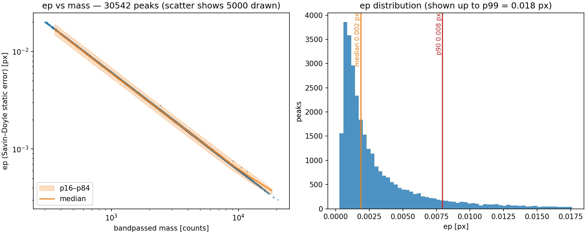
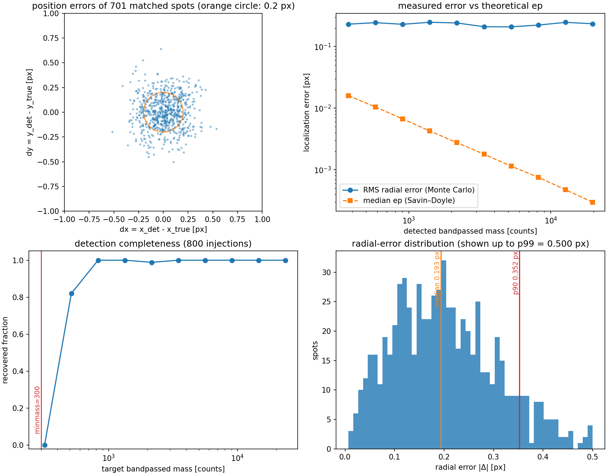

# 峰定位误差分析：社区做法、逐峰不确定度与人工斑注入验证

本文档记录 `26-07-31` 实验 `central_dot_0p18` 条件峰定位的误差分析，服务最终报告的方法学部分。前半调查三个相关社区的标准做法；后半给出本数据集的量化结果：逐峰 Savin–Doyle 静态误差（`ep`）与 ADDSTAR 式人工斑注入 Monte-Carlo 测试，以及两者与真实数据的交叉验证。算法本身（Crocker–Grier 质心、参数与二维高斯拟合对照）见 [peak-localization.md](peak-localization.md)；复现命令见 `analysis/26-07-31-derived-single-sweep/README.md`。

**结论先行**：流水线的总定位误差为每轴 RMS ≈ 0.16–0.17 px（径向中位 0.19 px、p90 0.35 px），且在全亮度范围内与 mass 无关。主导项不是探测器噪声（Savin–Doyle `ep` 仅 0.002 px 量级），而是有限掩膜质心的**确定性亚像素窗截断偏差**（每轴 RMS ≈ 0.13 px，相位依赖、半整数相位处最大约 0.2 px）。该偏差是两种估计量的共同模式，因此在此前的质心–高斯对照（中位差 0.052 px）中不可见——只有已知真值的注入测试能测出绝对误差。

## 社区做法调查

三个使用同一定位范式（滤波→找极大→亚像素质心/拟合）的社区，做法殊途同归：**解析公式给下界，仿真标定给可信区间，实测重复性给 sanity check**。

### 软物质微粒追踪（trackpy 原生社区）

- 理论：Savin & Doyle, *Biophys. J.* **88**, 623–638 (2005) 把误差分为 static error（定位噪声）与 dynamic error（运动模糊），给出质心定位 static error 的解析估计，trackpy 以 `trackpy.uncertainty.static_error` 实现：`ep = (noise/mass) × noise_size × √(Σx² over mask)`。
- trackpy 官方 [uncertainty 教程](http://soft-matter.github.io/trackpy/dev/tutorial/uncertainty.html) 的验证方式是用**已知真值的合成斑**在不同噪声水平下检验 `ep`；教程同时警告 `diameter` 偏小会把质心拉向像素边缘（有限窗口偏差的一种）。
- 实测金标准：追踪**固定不动的颗粒**（stuck/immobilized beads）跨多帧，取位置标准差直接测 static error；微流变文献还检查 MSD 零时延截距——随机定位误差给 MSD 加常数偏移（2D 时 4ε²），拟合时把它当已知噪声项减掉。Crocker & Grier 1996 原文即如此验证。

### 天文测光（DAOPHOT 谱系）

- 形式误差：DAOPHOT 的 PSF 拟合输出最小二乘协方差给出的参数误差（Stetson 1987）；解析传统有 King 1983 的像素阵列质心误差公式（标度 σ ~ FWHM/(2·SNR)）。
- 实战金标准是 **artificial star tests**：DAOPHOT 的 `ADDSTAR` 把已知位置和亮度的合成星注入**真实图像**（加 Poisson 噪声），重跑完整流程，比较回收值与真值——同时得到**误差标定（随亮度/拥挤度变化）和 completeness（检出率）**。惯例注入量控制在原星数的 ~5–15% 以免改变拥挤度，并跑多轮积累统计（例：[arXiv:1809.08123](https://arxiv.org/pdf/1809.08123)、[arXiv:0906.4017](https://arxiv.org/pdf/0906.4017)）。

### 单分子定位显微（SMLM，与 MCP 光子事件最同构）

- 解析公式：Thompson, Larson & Webb, *Biophys. J.* **82**, 2775–2783 (2002) 把定位精度写成光子散粒噪声、像素化、背景三项之和（简化极限 σ ≈ s/√N）；Ober, Ram & Ward (2004) 给出基本 CRLB；Mortensen et al. (2010) 给出 EMCCD 版本（电子倍增引入 √2 过剩噪声因子）。验证手段同样是仿真加重复定位分布对照。

对我们的直接启发：公式（`ep`、TLW）只覆盖噪声传播，测不到算法性与形态学系统偏差；合成数据仿真（trackpy 教程、ADDSTAR）是把系统偏差变成可测对象的标准方法；实测重复性（stuck beads）在本实验的单帧 regime 没有对应物（每帧是独立 realization，无静止颗粒可追）。

## 我们的实现

### 逐峰 `ep`：`localization_uncertainty.py`

对全量峰表（30542 峰）逐峰计算 Savin–Doyle static error（`trackpy.uncertainty.static_error`，`diameter=7, noise_size=1`）。两个实现选择：

- **噪声逐帧测**：`noise` = 未截零带通图（`gaussian(σ=1) − 7×7 boxcar`，与 `locate` 内部一致）的 MAD 稳健标准差（1.4826×MAD）。亮斑与脉冲噪声只占 ~0.1% 像素，对中位数估计可忽略。
- **不用 trackpy 的 `measure_noise`**：它把背景定义为"带通图非零像素膨胀后的补集"，在本数据稀疏帧上退化（带通截零后约半数像素仍非零，膨胀后背景几乎为空；合成 σ=3 帧上实测返回 15.5 而非 3），且它测的是原始图标准差，与带通量纲的 `mass` 不匹配。`mass` 的量纲已经核实：`locate` 内部 uint8 量化后在输出前除回 `scale_factor`（`feature.py`），存储的 `mass` 是带通 counts，与本脚本噪声同量纲。

输出：`detected-peaks/26-07-31_central_dot_0p18_peaks_ep.h5`（`frame, y, x, mass, ep` + 逐帧 `frame_noise`，完整 provenance 属性）；汇总图 `results/26-07-31_central_dot_0p18_ep_vs_mass.png`。

### 人工斑注入测试：`artificial_spot_test.py`

ADDSTAR 的对应物，注入发生在**真实帧**上（背景、读出噪声、脉冲噪声、拥挤都是实测的），每帧 4 斑 × 200 帧 = 800 次注入（相对每帧 ~30 个真实峰不改变帧性质；帧可复现抽样，`--n-frames 200 --seed 20260804`，脚本打印帧号清单）：

- **斑模型**：椭圆二维高斯，σ ~ U(2.4, 3.0) px（实测 FWHM 6–7 px），ecc ~ U(0, 0.6)（实测中位 ~0.26 带长尾），随机取向。
- **幅度标定**：目标带通 mass 对数均匀 250–30000（覆盖 `minmass=300` 阈值两侧到实测最亮 ~22000）；用无噪声单位剖面的带通 mass 精确反解 raw 总 counts，目标值按构造准确。
- **噪声模型**：帧 counts 不是光子数（背景 105 counts、读出 σ=3 → 方差/均值 = 0.086 ≠ Poisson 1），注入斑采样为 `Poisson(counts×G)/G`，G = 105/9 ≈ 11.7，使注入斑与背景有相同的每 count 方差（而非高估散粒噪声的裸 Poisson）。
- **匹配**：每个注入真值匹配 ≤2 px 内最近检出，记录 dy、dx、检出 mass 与检出峰的 `ep`。
- 输出：逐注入 CSV `results/26-07-31_central_dot_0p18_artificial_spots.csv`；四联图 `results/26-07-31_central_dot_0p18_artificial_spot_errors.png`。

## 结果

### 逐峰 `ep`（30542 峰）

- 逐帧噪声：中位 0.737 带通 counts（p5–p95：0.731–0.743），帧间极稳定；
- `ep`：中位 0.0019 px（p5–p95：0.0006–0.0115），严格 ∝ 1/mass（下图左）。

### 注入测试（800 次注入）

- **总误差**：每轴 RMS 0.167 / 0.161 px（y/x）；径向中位 0.193 px、p90 0.352 px、max 0.639 px；在检出 mass 300–24500 全范围内**与 mass 无关**（上图右上，平坦的蓝线）。
- **无整体系统偏移**：mean dy = +0.002 px、mean dx = +0.012 px。
- **亚像素相位偏差是主导项**：sin/cos 拟合幅度 0.136 (y) / 0.141 (x) px；偏差把质心拉向最近像素中心。无噪声 σ=2.55 高斯斑的直接测量：相位 0.125/0.25/0.375/0.5 处偏差 −0.053/−0.107/−0.162/+0.218 px——无限 SNR 下偏差依然存在，是确定性算法性质（半径 3 px 圆形掩膜把高斯截到 ±1.2σ，截断质心被拉向掩膜中心）。该偏差曲线每轴 RMS ≈ 0.13 px。
- 扣除单正弦模型后残差 RMS 0.138 / 0.126 px 且仍与 mass 无关：偏差曲线含高次谐波（近半整数相位处陡峭翻转），且幅度随 σ/ecc 在注入总体内变化，单一全局正弦无法吸收。随机噪声只在阈值附近可辨：mass ~300–560 区间残差 0.157 px 对高质量基线 0.13 px，平方差得噪声项 ≈ 0.09 px；mass >1000 时噪声项淹没在偏差谐波中。
- **`ep` 与实测的差距**：同 mass 分箱内 `ep` 中位 0.0003–0.015 px，比总误差低 1–2 个数量级（径向误差/ep 比值中位 79）。`ep` 只代表背景噪声经质心的传播下界；本数据集的瓶颈不是探测器噪声，而是有限掩膜质心的算法偏差。
- **完整性**：mass_target ≥ 300 时 92.1%（701/761）；50% 检出点 ≈330；高于阈值的漏检集中在 300–400（因下述 0.84 量化质量尺度，目标 300–360 实测低于 minmass），另有个别注入落在真实亮峰上未能在 2 px 内匹配。

### 真实数据交叉验证

注入测试测的是合成斑，必须确认结论适用于真实峰。用已有的真实峰"质心 vs 二维高斯拟合"逐峰 CSV（`results/26-07-31_central_dot_0p18_gauss_vs_centroid_peaks.csv`，1518 峰，剔除撞墙拟合后 1433 个）按**质心亚像素相位**分箱：

- x 方向差值（高斯−质心）：相位四分位 0–0.25 / 0.25–0.5 / 0.5–0.75 / 0.75–1 处均值 **+0.050 / +0.090 / −0.046 / −0.002 px**——符号与注入偏差曲线完全一致（相位 <0.5 质心被拉向负方向，故高斯−质心 > 0；>0.5 反之），证实真实峰存在同样的窗截断偏差。
- y 方向结构弱得多（−0.013 ~ −0.021 px，符号不完全一致），可能与 streak 时间轴方向斑宽略大、截断较弱有关；未进一步定量。
- 这也解释了此前对照"中位差 0.052 px"的真实含义：那是**两种共享部分偏差的估计量之差**，不是绝对误差。高斯拟合在同一半径 3 px 窗口内工作，吸收了部分偏差；绝对误差只有注入已知真值才能测得——这正是天文社区坚持 artificial star tests 的原因。

### 副产品：`locate` 的 uint8 量化质量尺度

检出 mass / 目标 mass = 0.80（p5–p95：0.70–0.84）；无噪声斑直接测量为 0.836。即 `locate` 内部把带通图量化成 uint8 的性能优化使记录的 mass 系统性偏小 ~16–20%（量化步长由帧内带通动态范围决定，故比例随帧略有变化）。此前审计只核实了该量化对**质心**的影响（<0.02 px），对 mass 量纲的影响是本次新发现： **`minmass=300` 的检出阈值对应未量化带通 counts ≈ 360**；下游凡用 mass 做亮度解释或阈值标定的，都应以检出 mass 为准。

### 误差预算汇总

| 成分 | 量级 | 性质 |
|---|---|---|
| 亚像素窗截断偏差 | 每轴 RMS ≈ 0.13 px；相位依赖，半整数相位处最大 ~0.2 px | 确定性，与 mass 无关，**主导项** |
| 背景 + 散粒噪声 | ≈ 0.09 px（mass ~400 处），随 mass 增大而减小 | 随机 |
| uint8 量化（对位置） | < 0.02 px | 确定性（已审计） |
| uint8 量化（对 mass） | ×0.80–0.84 比例因子 | 确定性 |
| Savin–Doyle `ep` | 0.0003–0.015 px（∝1/mass） | 仅背景噪声传播下界，非总误差 |

### 对当前与未来分析的影响

- 对现有分析（x 剖面四高斯拟合、密度图）：0.16 px/轴 远小于光斑结构尺度（σ_x = 12–17 px）与 1 px 分箱，无影响。
- 对未来亚像素级声明（同帧峰间距离/关联的精细结构）：该偏差是第一阶系统误差；它确定、可标定（逐相位逐 σ），需要时可用本次注入 CSV 标定扣除——但任何此类声明都必须先引用本测试而非 `ep`。

## 局限

- 注入斑形态（椭圆高斯，ecc ≤ 0.6）不覆盖极少数"亮核 + 斜向拉长晕"的离群形态；那类峰的定位偏差上界见 peak-localization.md 的高斯拟合对照。
- 注入噪声模型的增益 G = 11.7 由背景方差匹配推得，真实探测器增益未独立标定；但主结论（偏差主导）对该选择不敏感，噪声模型只在阈值 mass 附近影响结果。
- 完整性读数是"以目标 mass 计"；绝对阈值含 0.84 量化质量尺度，跨参数比较时注意。

## 可直接用于报告的表述

> The localization uncertainty of the spot finder was quantified with an artificial-spot (ADDSTAR-style) Monte-Carlo test: 800 synthetic elliptical-Gaussian spots with known subpixel positions, widths, eccentricities and brightnesses spanning the full detection range were injected into real streak frames (200 reproducibly sampled frames, 4 spots per frame) and re-detected with the production Crocker–Grier pipeline. The total localization error is 0.16–0.17 px RMS per axis (radial: median 0.19 px, 90th percentile 0.35 px), independent of spot brightness, and is dominated by a deterministic subpixel bias of the window-truncated brightness centroid (amplitude up to ≈0.2 px near half-integer pixel phases) rather than by detector noise: the Savin–Doyle static error, computed per peak from the measured bandpass background noise, is 0.002 px at the median brightness — two orders of magnitude smaller. The same subpixel-bias signature appears in the phase dependence of centroid-vs-Gaussian-fit differences on real peaks, corroborating the Monte-Carlo result on real data. Detection completeness is 92% above the nominal mass threshold; the 50% point is consistent with the threshold once the algorithm's internal 8-bit mass rescaling (×0.84) is accounted for. Positions are reported uncorrected; the characterized bias is far below the spatial scales of all analyses in this work (spot separations ≳ 12 px).
