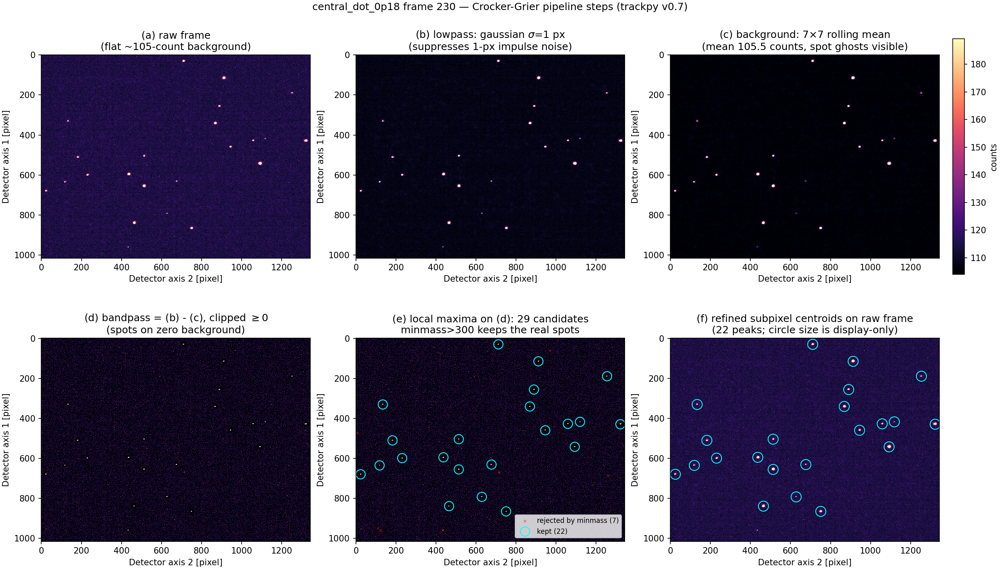
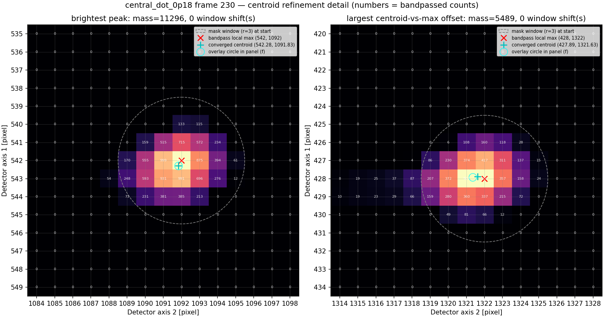
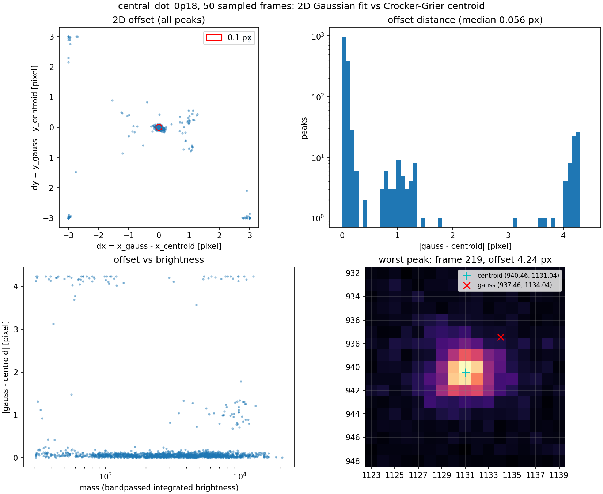
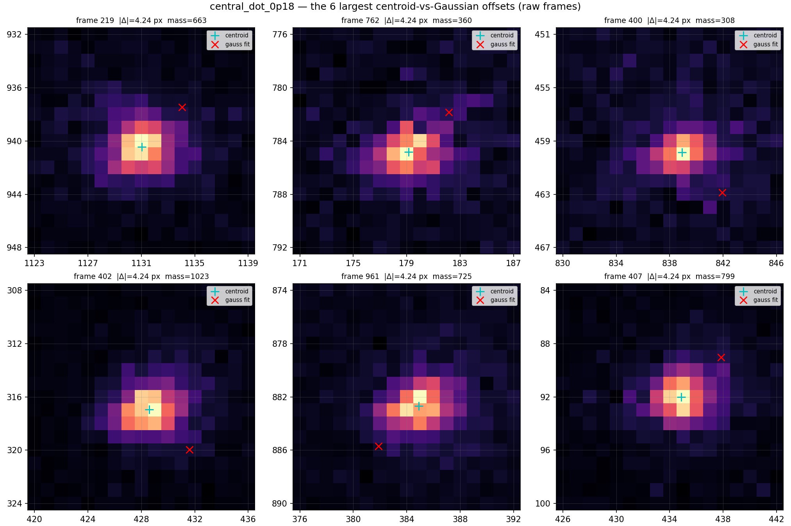

# 峰值定位：算法、圆心语义与对照验证

本文档记录单帧稀疏亮斑定位所用的算法、输出坐标的精确语义，以及"为什么用质心而不是二维高斯拟合"的对照证据。写报告的方法学部分时以此为准。数据为 `26-07-31` 实验 `central_dot_0p18` 条件（1000 帧），复现命令见 `analysis/26-07-31-derived-single-sweep/README.md`。

## 算法与圆心语义

定位用 `find_frame_peaks.py`，核心是 `trackpy.locate`(trackpy v0.7),即 Crocker–Grier 质心定位算法（Crocker & Grier, *J. Colloid Interface Sci.* **179**, 298–310 (1996),[DOI 10.1006/jcis.1996.0217](https://doi.org/10.1006/jcis.1996.0217);trackpy:Allan, Caswell, Keim, van der Wel, Verweij,[Zenodo DOI 10.5281/zenodo.4682814](https://doi.org/10.5281/zenodo.4682814))。这是数字视频显微颗粒定位的标准方法；同一"滤波→找极大→质心"范式也是天文测光（DAOPHOT,Stetson 1987）和 EMCCD/MCP 单光子事件重建的标准做法。

三个步骤（trackpy v0.7 实际实现，`feature.py` / `refine/center_of_mass.py` / `preprocessing.py`):

1. **带通滤波**：高斯低通 σ=1 px（压制单像素读出噪声）减去 7×7 boxcar 滚动均值（扣除 ~105 counts 的平坦背景与缓变成分），负值截零。滤波后背景 ≈ 0。
2. **候选检出**：带通图上的局部极大（灰度膨胀，最小间距 separation=8 px)，再按带通域积分亮度 `mass > minmass=300` 筛选；每帧 ~500 个单像素脉冲噪声的 mass ≲85，余量充足。`percentile=0` 关闭了 trackpy 默认的 64 分位亮度截断（该默认值针对致密胶体视频，在本数据稀疏帧上会误删真实暗峰）。
3. **亚像素质心精修**：以候选点为中心取半径 3 px 圆形掩膜窗口，在**带通图**上算亮度加权质心；若质心偏离窗口中心 >0.6 px，窗口整像素平移后重算，最多 10 次。坐标原点在像素 (0,0) 中心，与 `imshow` 一致。

参数标定：`diameter=7` 匹配实测斑 FWHM 6–7 px；其余参数为上述 trackpy 默认。

输出的 `(y, x)` 即第 3 步的浮点质心——**叠加审查图的圆心就是算法判定的峰位置**；圆圈的半径是固定显示标记（`markersize=12` pt ≈ 14 数据像素，约为斑 FWHM 的两倍），不携带任何物理信息。质心取自带通图（背景已减），因此不受平坦背景牵引，只对斑的亮度分布不对称敏感。一个实现细节：`locate` 内部把带通图量化成 uint8 再求质心（性能优化），对质心的影响 <0.02 px。

## 流程可视化（frame 230)

六联版对应上述三步：(a) 原始帧；(b) 高斯低通 σ=1；(c) 7×7 滚动均值背景（均值 105.5 counts，可见亮斑"鬼影"渗入背景估计，这正是要做带通减法的原因）;(d) 带通结果；(e) 候选检出——带通图上 29 个局部极大，`minmass>300` 砍掉 7 个噪声候选（红 ×)，保留 22 个（青 ○);(f) 精修质心画回原图。注意原图上的 ~500 个脉冲噪声经低通与间距筛后只剩 29 个候选，minmass 再完成最终区分。

精修放大（格内数字 = 带通后计数；灰虚线 = 半径 3 px 掩膜窗口；红 ✕ = 带通图局部极大起点；青 + = 收敛质心）：两个示例峰均 0 次窗口平移直接收敛。右图不对称斑（带通值可见左翼拖尾）的质心被拉到极大值左侧 0.39 px，这是质心对斑形态的正常响应。

## 对照验证：二维高斯拟合 vs 质心

`compare_gauss_refinement.py` 对 1000 帧中可复现抽取的 50 帧（`numpy default_rng`,seed=20260803，无放回）全部 1518 个检出峰，用 `tp.refine_leastsq`（圆对称二维高斯 + 常数背景，直接拟合原始帧）重定位置，与质心做差：

- **主体（92.2%,1399 峰，|Δ| ≤ 0.2 px)：差值中位 0.052 px,p90 = 0.11 px，无系统偏差**（均值 dy = −0.014 px、dx = +0.017 px)。对形状良好的斑，两种估计量给出同一位置。
- **离群（7.8%,119 峰 > 0.2 px）全部来自高斯拟合失效。** `refine_leastsq` 把拟合中心限制在初始位置 ±3 px 内（掩膜半径，`least_squares.py` 的 `validate_bounds`)，而离群差值就堆在边界上：|Δ| > 1 px 的 92 个峰中 60 个贴着 (±3, ±3) 角，整个样本的 p99 = max = 4.2426 px = 3√2，即拟合撞墙。
- 离群与亮度无关（mass 中位数 3013 vs 3269)、与拥挤无关（两组 8 px 内均无近邻）、与 trackpy 偏心率诊断无关（ecc 中位 0.257 vs 0.259)。逐一看最大的几个离群峰（下图）：形态均为亮核加斜向拉长晕，非单一圆高斯所能描述；高斯中心被拉长翼拖离斑体直到边界，而质心始终停在亮核上。

逐峰数据：`results/26-07-31_central_dot_0p18_gauss_vs_centroid_peaks.csv`（每行 `frame,y_centroid,x_centroid,y_gauss,x_gauss,dy,dx,mass,ecc`),1518 行，拟合失败（cost=NaN)0 个。

**结论**：对良好高斯斑，质心与高斯拟合一致（差值中位 0.05 px 量级）；对本数据集中实际存在的非高斯斑，质心是稳健的描述统计量，高斯拟合则会发散到边界。选择 Crocker–Grier 质心不需要额外辩护——它就是通用判据，且上述对照表明它在本数据上比二维高斯拟合更稳健。

## 可直接用于报告的表述

> Spots were located with the Crocker–Grier algorithm (Crocker & Grier, J. Colloid Interface Sci. 179, 298 (1996)) as implemented in trackpy v0.7: bandpass filter (Gaussian σ = 1 px minus 7×7 boxcar), local-maxima detection with an 8 px minimum separation, and iterative brightness-centroid refinement to subpixel precision within a circular mask of radius 3 px (diameter 7 px, minmass 300, percentile filter disabled). Cross-validation against circular 2D Gaussian least-squares fits on a 50-frame sample (1518 spots) shows agreement with a median deviation of 0.05 px for Gaussian-like spots; the few percent of non-Gaussian, elongated events where the fit diverges are localized robustly by the centroid.

定位误差的完整量化（逐峰 Savin–Doyle `ep`、ADDSTAR 式人工斑注入验证、亚像素窗截断偏差的发现）见 [peak-localization-error.md](peak-localization-error.md)。
